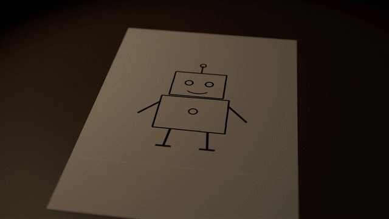
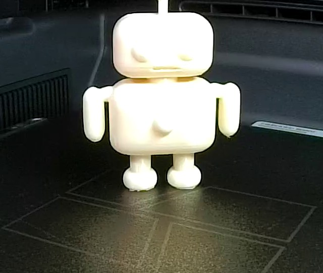
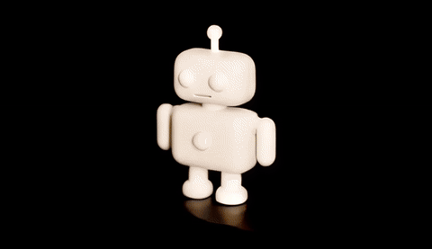
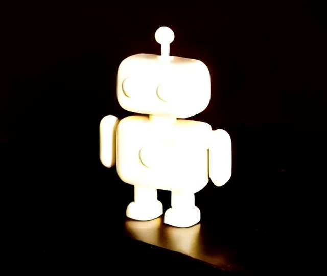
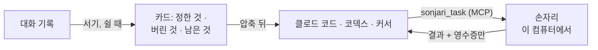
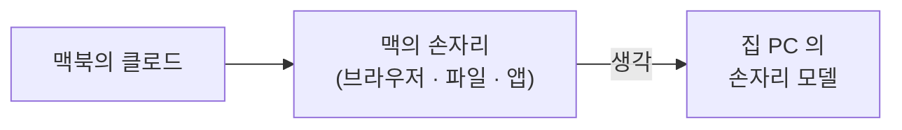

<h1 align="center">손자리 (Sonjari)</h1>

<p align="center">
  <b>클로드가 일을 넘기는, 윈도우 · 맥의 무료 로컬 AI 에이전트</b><br>
  내 크롬 · 내 파일 · 내 그래픽카드로 일하고, 결과와 함께 어디를 보고 했는지 돌려줍니다.
</p>

<p align="center">
  <a href="LICENSE"></a>
  
  
  <a href="https://apps.microsoft.com/detail/9N458V8HPTR2"></a>
  <a href="https://github.com/sonjari/sonjari/releases/latest"></a>
  <a href="https://glama.ai/mcp/servers/sonjari/sonjari"></a>
</p>

<p align="center">
  <a href="README.md">English</a> ·
  <a href="https://sonjari.com">sonjari.com</a> ·
  <a href="#설치">설치</a> ·
  <a href="#확장팩-만드는-것도-합니다">확장팩</a> ·
  <a href="docs/guide/measurements.ko.md">잰 숫자</a>
</p>

---

클로드 코드가 MCP 로 손자리에게 조사를 넘깁니다. 손자리는 이 PC 에서 페이지를 읽고, 답과 출처, 짧은 영수증만
클로드에게 돌려줍니다. 4배속입니다.

https://github.com/user-attachments/assets/415a77b1-6126-45cb-afd3-88bf71ddbea9

## 하는 일

생각은 쓰던 AI 가 계속 합니다. 손자리는 느리고 비싼 부분을 맡아 내 기기에서 합니다.

<table>
<tr><td><b>클로드 · 코덱스 · 커서의 일을 받아서</b></td><td>MCP 한 번으로 일을 통째로 넘겨받습니다. 페이지는 내 기기에서 읽으니, 쓰던 AI 의 대화 창과 사용 한도가 덜 닳습니다. <a href="docs/guide/mcp.ko.md">MCP 안내</a></td></tr>
<tr><td><b>로그인해 둔 내 크롬에서</b></td><td>내 계정 그대로 사이트를 열고 누르고 읽습니다. 옆에서 지켜보다 끼어들 수 있고, 로그인 · 보안 문자 · 결제 화면에서는 멈추고 사람에게 넘깁니다. <a href="docs/guide/browser.ko.md">브라우저</a></td></tr>
<tr><td><b>내 그래픽카드로 만들기까지</b></td><td>확장팩을 켜면 3D 모델 · 프린트 파일, 영상 시안, 유니티 에디터 잇기가 더해집니다. 평소엔 꺼져 있고, 필요할 때 클로드가 「켤까요?」 하고 묻습니다. <a href="#확장팩-만드는-것도-합니다">확장팩</a></td></tr>
<tr><td><b>영수증을 남깁니다</b></td><td>할 때마다 걸음 · 읽은 페이지 · 값마다 출처를 남깁니다. 도구가 준 적 없는 숫자는 표시합니다. <a href="#확인할-수-있게-만들었습니다">확인할 수 있게</a></td></tr>
<tr><td><b>폰으로도 시킵니다</b></td><td>내 디스코드 봇에 말을 걸면 집 PC 가 일합니다. 승인은 PC 에서만 합니다. <a href="docs/guide/remote.ko.md">디스코드</a></td></tr>
</table>

혼자서도 일합니다. 한 줄로 시키면 엑셀 파일이 나옵니다. 깃허브 인기 저장소 페이지를 열어 파이썬 상위 세 개의
이름 · 별 수 · 설명을 표로 저장했습니다. 약 9배속이고, 실제로는 RTX 3090 에서 2분 46초 걸렸습니다.

https://github.com/user-attachments/assets/91763b31-fe72-4614-b574-b3457ef0518c

## 설치

2분이면 깔리고, 단추 하나로 쓰던 AI 에 이어집니다.

| | |
|---|---|
| **윈도우** | [마이크로소프트 스토어](https://apps.microsoft.com/detail/9N458V8HPTR2) — 무료 · 알아서 업데이트 |
| **맥**(애플 실리콘 · macOS 13 이상) | [dmg 받기](https://github.com/sonjari/sonjari/releases/latest) — 애플 서명 · 공증 |
| **클로드에 잇기** | 앱에서 **연결** 한 번(클로드 코드 · 클로드 데스크톱 · 코덱스 · 커서). 직접 하려면 [MCP 안내](docs/guide/mcp.md) |

처음 켜면 마법사가 이 기기를 재서 맞는 모델을 골라 받고, 한 번 돌려 봅니다.
집에는 윈도우 PC, 들고 다니는 건 맥북이라면 둘을 짝지으세요. 맥에서 시켜도 집 PC 그래픽카드가 생각합니다.

## 확장팩: 만드는 것도 합니다

브라우저 밖의 일도 합니다. 확장팩을 켜면 클로드가 계획하고, 손자리가 내 그래픽카드로 만듭니다.
왼쪽은 만드는 모습, 오른쪽은 실제로 나온 것입니다.

<table>
<tr>
<td width="60%"><a href="https://www.youtube.com/watch?v=cAqdbsfF9Bk"></a></td>
<td width="40%"></td>
</tr>
<tr><td colspan="2"><b>3D 팩</b> — 그림 한 장으로 3D 모델을 만들고, 프린트 파일까지 뽑습니다. RTX 3060 12GB 에서 130~143초(같은 그림 3번) · 나누지 않고 통째로 출력(100mm). <a href="docs/guide/packs.ko.md#3d-팩">자세히</a></td></tr>
<tr>
<td></td>
<td></td>
</tr>
<tr><td colspan="2"><b>영상 팩</b> — 클로드가 콘티를 짜면, 손자리가 컷 시안을 굽고 한 컷씩 검사합니다. 이 3초 컷은 RTX 3090 에서 40.5초 · RTX 3060 12GB 에서는 컷 하나에 31~57초(4번 잼) · AI 생성 영상 · 윈도우. <a href="docs/guide/packs.ko.md#영상-팩">자세히</a></td></tr>
</table>

▶ 47초 전체 영상: https://www.youtube.com/watch?v=cAqdbsfF9Bk

| 팩 | 하는 일 | 윈도우 | 맥 | 잰 기기 |
|---|---|:---:|:---:|---|
| [3D](docs/guide/packs.ko.md#3d-팩) | 그림 → 3D 모델(GLB) → 프린트 파일(STL · 3MF) · 블렌더로 다듬기 | ✅ | ✅ | RTX 3060 12GB · 맥 16GB(512 해상도만) |
| [영상](docs/guide/packs.ko.md#영상-팩) | 콘티 → 컷 시안 · 한 컷씩 검사(멈춘 화면 · 너무 어두움 · 깨진 장면 · 소리) | ✅ | — | RTX 3060 12GB |
| 유니티 | 열려 있는 유니티 에디터를 읽고 고치고, 되돌리기까지 | ✅ | ✅ | 유니티 |
| 영상 읽기 | 참고 영상을 장면 단위로 읽어 표로 | ✅ | ✅ | — |

0.4.49 부터 3D 팩과 영상 팩은 [PolyForm Noncommercial](https://polyformproject.org/licenses/noncommercial/1.0.0) 과 [PolyForm Small Business](https://polyformproject.org/licenses/small-business/1.0.0) 1.0.0 중 맞는 쪽을 고르시면 됩니다.
개인 · 비상업 용도, 그리고 100명 미만이면서 연 매출 100만 달러(2019년 달러 · 물가 반영) 미만인 회사는 무료입니다. 그보다 큰 회사는 [연락 주세요](https://github.com/sonjari/sonjari/discussions).
앱 본체와 나머지 팩은 그대로 Apache-2.0 입니다.

## 왜 서브에이전트로 만들었나

그럼 왜 쓰던 AI 에 도구를 더 주지 않고, 다른 에이전트에게 넘길까요?

생각은 주 에이전트(클로드)가 해야 합니다. 서브에이전트는 귀찮고 비싼 부분을 맡아야 합니다. 사이트를 이리저리
누르고, 페이지 스무 장을 읽고, 3D 를 굽는 일입니다. 그런데 대부분은 그 부분도 같은 유료 모델, 같은 사용 한도로 돕니다.



**도구가 아니라 에이전트인 까닭.** 손자리가 클로드에게 브라우저 도구만 빌려주면, 클로드는 여전히 모든 페이지를 제 창으로
읽느라 돈을 씁니다. 그래서 손자리는 일을 통째로 내 컴퓨터에서 끝내고 결과만 돌려줍니다.

같은 가격 조사 과제 · 클로드 코드(`claude-sonnet-5`)가 지휘 · 방식마다 27줄:

| 클로드가 페이지를 얻은 방법 | 온전한 한 줄당 클로드 비용 |
|---|---|
| 일반 브라우저 도구(Playwright MCP) | $0.635 |
| 클로드 혼자(웹 읽기 · 검색) | $0.246 |
| 손자리 브라우저 도구를 클로드가 직접 | $0.074–0.100 |
| 일을 통째로 손자리에게 | $0.075–0.090 |

표본이 작고 일부 줄은 손으로 채점했습니다. 그리고 느립니다. 과제 하나에 6~7분, 클로드 혼자는 약 1.5분입니다.
단서 전부: [잰 숫자](docs/guide/measurements.ko.md).

- **사용 한도에 걸려 멈춘 클로드 코드를 이어받습니다.** 어느 대화가 어디까지 했는지 이 PC 기록에서 찾습니다.
- **압축된 뒤에도 정한 것을 남깁니다.** 서기가 정한 것 · 버린 것 · 남은 일을 원문 인용과 함께 카드로 남깁니다. 기본은 꺼짐입니다.

## 내 기기에서 도나요?

처음 켤 때 기기에 맞는 모델을 고릅니다. 보통은 이렇게 됩니다.

| 내 기기 | 손자리가 권하는 모델 |
|---|---|
| RTX 3090 · 4090 · 5090(24GB 이상) | 가장 큰 모델(27B) |
| 16GB 카드 | 같은 모델의 압축판 |
| 12GB 카드 | 중간 모델(9B) |
| 8GB 카드 | 9B 압축판 · 글만 읽기 |
| 6GB 노트북 | 4B 압축판 · 글만 읽기 — 약함 · 쓰던 AI 와 나눠 쓰기를 권함 |
| **맥 16GB 혼자** | 9B 압축판 · 글만 읽기. 첫 질문은 2분쯤, 그다음부터는 10초쯤 |
| **맥 + 집 PC 짝짓기** | 집 PC 의 모델을 PC 그래픽카드로 |



## 확인할 수 있게 만들었습니다

- **어디를 봤는지 남깁니다.** 걸음마다 읽은 페이지와 숫자가 나온 자리가 남습니다.
- **근거 없는 건 표시합니다.** 도구가 준 적 없는 숫자는 따로 표시하고, 다 못 끝낸 일은 어디서 멈췄는지 말합니다.
- **되돌릴 수 없는 버튼은 사람이 누릅니다.** 보내기 · 올리기 · 결제 · 지우기는 앱의 승인 카드를 기다립니다.

잘 안 된 판까지 우리가 가진 숫자는 전부 여기 있습니다: [잰 숫자](docs/guide/measurements.ko.md).

**알아둘 점(맥):** 맥 혼자 쓰면 첫 질문에 2분쯤 걸리고(모델이 도구와 지침을 처음 읽는 시간), 그다음부터는 10초쯤입니다.
16GB 맥 혼자서 긴 웹 조사는 몇 분 걸립니다 — 집 PC 와 짝지으면 PC 그래픽카드로 합니다. 영상 팩은 윈도우에서만 됩니다.

## 다음에 할 것

| | 지금 어디까지 |
|---|---|
| 큰 모델을 작은 카드에서 — 전문가를 램으로 돌려, 6GB 노트북에서도 35B 모델을 | 일부 들어감(램 부스트) · 재는 중 |
| 맥: 첫 질문도 빠르게 — 모델을 받자마자 미리 데워 두기 | 설계 중 |
| 맥: 3D · 영상 일을 집 PC 로 보내기 | 설계 중 |
| 블렌더 작업대 — 렌더 · 자동 뼈 넣기 · 유니티로 내보내기 | 설계 중 |
| AMD 그래픽카드 | 나중에 |

먼저 원했으면 하는 게 있으면 [토론 게시판](https://github.com/sonjari/sonjari/discussions)에 남겨 주세요.

## 더 읽을 것

| 이런 걸 알고 싶다면 | 읽을 것 |
|---|---|
| 만든 사람이 실제로 어떻게 쓰는지, 실제 숫자로 | [만든 사람이 쓰는 법](docs/guide/workflows.ko.md) |
| 클로드 코드 · 코덱스 · 커서에서 손자리 쓰기 | [MCP 사용법](docs/guide/mcp.ko.md) |
| 다른 AI 가 손자리를 쓸 때 내 PC 밖으로 정확히 무엇이 나가는지 | [내 PC 밖으로 나가는 것](docs/guide/privacy.ko.md) |
| 내게 어떤 모델이 왜 깔렸는지, 안 들어가면 어떻게 하는지 | [모델을 고르는 방식](docs/guide/models.ko.md) |
| 일하는 요령이나 한 분야를 더하기 — 스킬, 스킬팩, 분야 팩(게임 · 영상) | [스킬과 팩](docs/guide/packs.ko.md) |
| 잰 것 전부와 그 한계 | [잰 것](docs/guide/measurements.ko.md) |
| 무엇을 지키는지 — 로컬 먼저 · 미터기 없음 · 정직한 결과 · 되돌릴 수 없는 단추는 사람이 | [약속](docs/why.ko.md) |

## 문서

| 이런 걸 알고 싶다면 | 읽을 것 |
|---|---|
| 만든 사람이 실제로 어떻게 쓰는지, 실제 숫자로 | [만든 사람이 쓰는 법](docs/guide/workflows.ko.md) |
| 클로드 코드 · 코덱스 · 커서에서 손자리 쓰기 | [MCP 사용법](docs/guide/mcp.ko.md) |
| 다른 AI 가 손자리를 쓸 때 내 PC 밖으로 정확히 무엇이 나가는지 | [내 PC 밖으로 나가는 것](docs/guide/privacy.ko.md) |
| 내게 어떤 모델이 왜 깔렸는지, 안 들어가면 어떻게 하는지 | [모델을 고르는 방식](docs/guide/models.ko.md) |
| 일하는 요령이나 한 분야를 더하기 — 스킬, 스킬팩, 분야 팩(게임 · 영상) | [스킬과 팩](docs/guide/packs.ko.md) |
| 잰 것 전부와 그 한계 | [잰 것](docs/guide/measurements.ko.md) |
| 무엇을 지키는지 — 로컬 먼저 · 미터기 없음 · 정직한 결과 · 되돌릴 수 없는 단추는 사람이 | [약속](docs/why.ko.md) |

## 참여하기

> **어떤 일을 하시든, 당신의 현장이 손자리의 선생입니다.**
> 당신이 알려 준 실패는 손자리가 앞으로 영원히 통과해야 할 시험이 됩니다.

내 그래픽카드에서 재 보기, 두 줄짜리 JSON 으로 사이트 하나 고치기, 잘못된 판 알려 주기, 글만 든 스킬팩, 시험 하나를 붙인 코드.
자세한 것은 [CONTRIBUTING.ko.md](CONTRIBUTING.ko.md) 에 있습니다.

## 개발

```powershell
powershell -NoProfile -ExecutionPolicy Bypass -File scripts\install.ps1
.venv\Scripts\python.exe -m alture_jarvis
.venv\Scripts\python.exe -m pytest tests -q -p no:cacheprovider
cd ui; npm ci; npm run build
```

기본값을 바꿀 때만 `.env.example`을 `.env`로 복사합니다. `.env`·`data/`·OAuth 토큰·브라우저 프로필은 커밋하지 마세요.
내부 이름(패키지 `alture_jarvis`·환경변수 `JARVIS_*`·헤더 `X-JARVIS-TOKEN`)은 예전 이름에서 왔고,
이미 깔린 설치가 끊기지 않도록 그대로 둡니다.

손자리는 두 사람이 유지합니다. 답이 늦을 수 있습니다. 코드의 많은 부분을 Claude(Anthropic)와 함께 씁니다 — 커밋에
`Co-Authored-By` 줄이 붙습니다 — 그리고 모든 변경은 유지하는 사람이 직접 돌려 보고 확인한 뒤 내보냅니다.

## 라이선스

Apache License 2.0 — [LICENSE](LICENSE) · [NOTICE](NOTICE).
외부 부품은 각자의 라이선스를 따릅니다(`packaging/THIRD_PARTY_NOTICES.md`).
선택 설치인 카메라 모듈은 Ultralytics YOLO(AGPL-3.0)를 쓰며 **기본 설치에는 들어가지 않습니다.**
「Sonjari」 · 「손자리」와 손자리 로고는 상표입니다. 라이선스는 코드에 대한 것이고 이름 · 로고에 대한 것이 아닙니다
(Apache-2.0 제6조). 갈래(fork)는 다른 이름으로 얼마든지 환영합니다.
