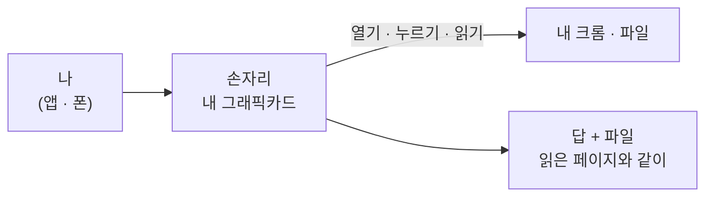
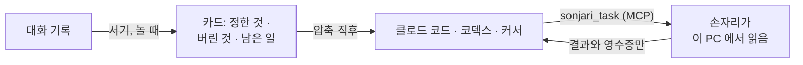

<h1 align="center">손자리 (Sonjari)</h1>

<p align="center">
  <b>An AI coworker that works in your own browser.</b><br>
  내 그래픽카드에서 돌아서 사용 한도도, 요금도 없습니다.
</p>

<p align="center">
  <b>The seat next to Claude Code.</b><br>
  클로드 코드가 한도에 걸려도, 대화가 압축돼도 손자리가 이어 받습니다.
</p>

<p align="center">
  <a href="LICENSE"></a>
  
  <a href="https://apps.microsoft.com/detail/9N458V8HPTR2"></a>
  
</p>

<p align="center">
  <a href="README.md">English</a> ·
  <a href="https://sonjari.com/ko/">sonjari.com</a> ·
  <a href="CONTRIBUTING.ko.md">참여하기</a> ·
  <a href="https://github.com/sonjari/sonjari/discussions">토론</a> ·
  <a href="SECURITY.md">보안 제보</a>
</p>

---

## 내 브라우저에서 일하는 AI 동료



한 문장을 주면 엑셀 파일이 나옵니다. 사람인에서 서울 마케팅 공고 3개를 찾아 회사, 공고명, 마감일을 엑셀로 정리했습니다.
영상은 9배쯤 빠르게 돌렸고, 실제로는 RTX 3090 · Qwen3.8 27B 로 3분 42초 걸렸습니다.

https://github.com/user-attachments/assets/59d554d6-208b-4e10-9944-37c8a9222e49

| 이런 걸 합니다 | 어떻게 | 자세히 |
|---|---|---|
| **로그인된 내 크롬에서 일하고, 그걸 눈으로 봅니다** | 이 PC 의 크롬 프로필에서 페이지를 열고 누르고 읽습니다. 「손자리의 컴퓨터」에 지금 페이지와 진행이 보이고, 도중에 말을 덧붙여 방향을 바꿀 수 있습니다. 로그인 · 보안 문자 · 결제 앞에서는 멈추고 넘깁니다. | [브라우저](docs/guide/browser.ko.md) |
| **한 번 잘 해낸 일은 다음엔 그대로 합니다** | 깔끔하게 끝난 판이면 그 걸음을 레시피로 남길지 묻습니다. 걸음마다 화면에 있어야 할 결과가 붙고, 다음엔 맞는 화면을 바로 열어 걸음마다 확인합니다. | [레시피](docs/guide/recipes.ko.md) |
| **폰에서 시킵니다** | 내 디스코드 봇에게 말하면 집 PC 가 일하고 같은 대화로 답합니다. 승인은 PC 에서만 합니다. | [디스코드](docs/guide/remote.ko.md) |
| **엑셀 · 워드 · 한글 · PDF** | 허락한 폴더 안에서 워드 · 엑셀 · 파워포인트 · 한글(hwpx) · PDF 를 읽고 씁니다. | [만든 사람이 쓰는 법](docs/guide/workflows.ko.md) |

## 클로드 코드의 옆자리



클로드 코드가 조사를 MCP 로 손자리에게 넘깁니다. 페이지는 이 PC 에서 손자리가 읽고, 클로드에게는 답과 출처만 돌아갑니다.
영상은 4배속입니다.

https://github.com/user-attachments/assets/0452bde3-c1c2-48f1-ba77-7b543faa22d6

| 이런 걸 합니다 | 어떻게 | 자세히 |
|---|---|---|
| **쓰던 클로드 · 코덱스 · 커서가 무거운 읽기를 맡깁니다** | MCP 의 `sonjari_task`. 페이지는 이 PC 가 읽고 결과만 돌아가서, 그 AI 의 대화 창과 사용 한도를 아낍니다. 가격 과제 하나에서 온전한 줄 하나당 클로드 비용이 손자리와 함께면 0.074~0.100달러, 클로드 혼자면 0.246달러였습니다. | [MCP 사용법](docs/guide/mcp.ko.md) |
| **한도로 멈춘 클로드 코드를 이어 갑니다** | 이 PC 에 남은 기록에서 어느 대화가 어디까지 했는지 찾아, 어떻게 이어 갈지 묻습니다. 코드는 따로 만든 가지에서 고칩니다. | [만든 사람이 쓰는 법](docs/guide/workflows.ko.md) |
| **압축돼도 정한 것을 잊지 않습니다(서기)** | 손자리가 노는 시간에 클로드 코드 대화 기록을 읽어 정한 것 · 버린 것 · 남은 일을 카드로 적습니다. 줄마다 기록의 줄 번호와 인용이 붙고, 압축 직후 클로드에게 다시 넣어 줍니다. 기본은 꺼져 있습니다. | [서기](docs/guide/scribe.ko.md) |

## 내 PC 에서 도나요

| 필요한 것 | |
|---|---|
| 윈도우 | 10(19041) 이상, x64 |
| 그래픽카드 | NVIDIA(아래 표). AMD · 인텔 카드는 아직 재 보지 않았습니다 |
| [Ollama](https://ollama.com) | 첫 실행 마법사가 설치를 안내합니다 |
| 크롬 | 브라우저 일에 씁니다(크롬이 없으면 엣지로 붙습니다) |

| 내 그래픽카드 | 손자리가 권하는 것 |
|---|---|
| RTX 3090 · 4090 · 5090 (24GB 이상) | 가장 큰 모델(27B) |
| RTX 4060 Ti 16GB · 4070 Ti Super · 4080 · 5070 Ti · 5080 (16GB) | 같은 모델의 압축판 |
| RTX 3060 12GB · 4070 · 5070 (12GB) | 중간 모델(9B) |
| RTX 3060 Ti · 3070 · 4060 · 노트북의 4060 · 5050 (8GB) | 중간 모델(9B) 압축판 · 글만 읽기(그림은 못 읽음) |
| 노트북의 3050 · 4050 (6GB) | 작은 모델(4B) 압축판 · 글만 읽기 — 약합니다. 쓰던 AI와 나눠 쓰는 것을 권합니다 |

## 설치

1. [마이크로소프트 스토어](https://apps.microsoft.com/detail/9N458V8HPTR2)에서 받습니다. 무료이고 알아서 업데이트됩니다.
2. 처음 켜면 마법사가 이 PC 를 재서 맞는 모델을 고르고, 받고(수 GB), 한 번 돌려 확인합니다.
   ([처음 실행 영상](https://github.com/user-attachments/assets/64083df8-8a9d-4a8d-8ba1-3572408d27a7))
3. 앱에서 **연결**을 누르면 클로드 코드 · 클로드 데스크톱 · 코덱스 · 커서에 손자리가 들어갑니다. 원래 설정은 먼저 백업합니다.
   손으로 하려면 [MCP 사용법](docs/guide/mcp.ko.md).

소스로 돌리기: [개발](#개발).

## 확인할 수 있게 만들었습니다

- **어디를 봤는지 보여 줍니다.** 판마다 걸음, 읽은 페이지, 값마다 어디서 왔는지가 남습니다.
- **받쳐 줄 근거가 없으면 표시합니다.** 도구가 준 적 없는 숫자는 표시하고, 덜 끝난 일은 어디서 멈췄는지 말합니다.
- **되돌릴 수 없는 단추는 사람이 누릅니다.** 보내기 · 올리기 · 결제 · 지우기는 앱의 승인 카드를 기다립니다.

잘 안 된 판까지 포함한 숫자는 전부 [잰 것](docs/guide/measurements.ko.md)에 있습니다.

**모자란 곳:** 윈도우 · NVIDIA 만 · 클라우드 AI 보다 느림 · 작은 카드에서는 긴 조사가 절반쯤에서 멈춤 · 자동 완성 칸, 날짜 고르기,
쿠키 안내 창 같은 까다로운 조작에서 자주 틀림.

## 문서

| 이런 걸 알고 싶다면 | 읽을 것 |
|---|---|
| 만든 사람이 실제로 어떻게 쓰는지, 실제 숫자로 | [만든 사람이 쓰는 법](docs/guide/workflows.ko.md) |
| 클로드 코드 · 코덱스 · 커서에서 손자리 쓰기 | [MCP 사용법](docs/guide/mcp.ko.md) |
| 다른 AI 가 손자리를 쓸 때 내 PC 밖으로 정확히 무엇이 나가는지 | [내 PC 밖으로 나가는 것](docs/guide/privacy.ko.md) |
| 내게 어떤 모델이 왜 깔렸는지, 안 들어가면 어떻게 하는지 | [모델을 고르는 방식](docs/guide/models.ko.md) |
| 일하는 요령이나 한 분야를 더하기 — 스킬, 스킬팩, 분야 팩(게임 · 영상) | [스킬과 팩](docs/guide/packs.ko.md) |
| 잰 것 전부와 그 한계 | [잰 것](docs/guide/measurements.ko.md) |
| 왜 만들었는지, 무엇을 지키는지 | [왜 만들었나](docs/why.ko.md) |

## 참여하기

> **어떤 일을 하시든, 당신의 현장이 손자리의 선생입니다.**
> 당신이 알려 준 실패는 손자리가 앞으로 영원히 통과해야 할 시험이 됩니다.

내 그래픽카드에서 재 보기, 두 줄짜리 JSON 으로 사이트 하나 고치기, 잘못된 판 알려 주기, 글만 든 스킬팩, 시험 하나를 붙인 코드.
자세한 것은 [CONTRIBUTING.ko.md](CONTRIBUTING.ko.md) 에 있습니다.

## 개발

```powershell
powershell -NoProfile -ExecutionPolicy Bypass -File scripts\install.ps1
.venv\Scripts\python.exe -m alture_jarvis
.venv\Scripts\python.exe -m pytest tests -q -p no:cacheprovider
cd ui; npm ci; npm run build
```

기본값을 바꿀 때만 `.env.example`을 `.env`로 복사합니다. `.env`·`data/`·OAuth 토큰·브라우저 프로필은 커밋하지 마세요.
내부 이름(패키지 `alture_jarvis`·환경변수 `JARVIS_*`·헤더 `X-JARVIS-TOKEN`)은 예전 이름에서 왔고,
이미 깔린 설치가 끊기지 않도록 그대로 둡니다.

손자리는 두 사람이 유지합니다. 답이 늦을 수 있습니다. 코드의 많은 부분을 Claude(Anthropic)와 함께 씁니다 — 커밋에
`Co-Authored-By` 줄이 붙습니다 — 그리고 모든 변경은 유지하는 사람이 직접 돌려 보고 확인한 뒤 내보냅니다.

## 라이선스

Apache License 2.0 — [LICENSE](LICENSE) · [NOTICE](NOTICE).
외부 부품은 각자의 라이선스를 따릅니다(`packaging/THIRD_PARTY_NOTICES.md`).
선택 설치인 카메라 모듈은 Ultralytics YOLO(AGPL-3.0)를 쓰며 **기본 설치에는 들어가지 않습니다.**
「Sonjari」 · 「손자리」와 손자리 로고는 상표입니다. 라이선스는 코드에 대한 것이고 이름 · 로고에 대한 것이 아닙니다
(Apache-2.0 제6조). 갈래(fork)는 다른 이름으로 얼마든지 환영합니다.
