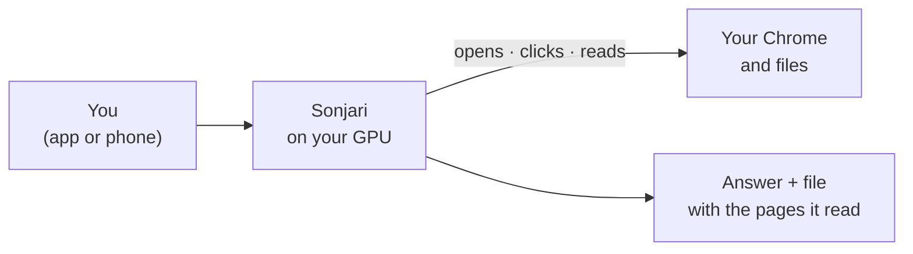
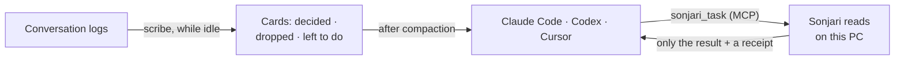

<h1 align="center">Sonjari (손자리)</h1>

<p align="center">
  <b>An AI coworker that works in your own browser.</b><br>
  Runs on your GPU. No usage limits, no meter.
</p>

<p align="center">
  <b>The seat next to Claude Code.</b><br>
  When it runs out of usage or forgets after compaction, Sonjari picks it up.
</p>

<p align="center">
  <a href="LICENSE"></a>
  
  <a href="https://apps.microsoft.com/detail/9N458V8HPTR2"></a>
  
</p>

<p align="center">
  <a href="README.ko.md">한국어</a> ·
  <a href="https://sonjari.com">sonjari.com</a> ·
  <a href="CONTRIBUTING.md">Contributing</a> ·
  <a href="https://github.com/sonjari/sonjari/discussions">Discussions</a> ·
  <a href="SECURITY.md">Security</a>
</p>

---

## An AI coworker in your own browser



One sentence in, an Excel file out. Sonjari opens GitHub Trending, reads the top three Python repositories and saves name,
stars and description as a table. Shown at about 9x; the real run took 2 min 46 s on an RTX 3090 with Qwen3.8 27B.

https://github.com/user-attachments/assets/91763b31-fe72-4614-b574-b3457ef0518c

| It does this | How | More |
|---|---|---|
| **Works in your logged-in Chrome — and you can watch** | Opens, clicks and reads pages in a Chrome profile on your PC. "Sonjari's computer" shows the page and the progress; add a note mid-task to change direction. Stops at login, CAPTCHA and payment and hands the screen to you. | [Browser](docs/guide/browser.md) |
| **A job it did well once, it follows next time** | After a clean run it offers to keep the steps as a recipe, each step with the result it should see. Next time it opens the right screen directly and checks every step. | [Recipes](docs/guide/recipes.md) |
| **Give it work from your phone** | Message your own Discord bot; the PC at home does the job and answers in the same chat. Approvals stay on the PC. | [Discord](docs/guide/remote.md) |

## The seat next to Claude Code



Claude Code hands the research to Sonjari over MCP. Sonjari reads the release page on this PC and only the answer, its
source and a short receipt go back to Claude. Claude then checks it. Shown at 4x.

https://github.com/user-attachments/assets/415a77b1-6126-45cb-afd3-88bf71ddbea9

| It does this | How | More |
|---|---|---|
| **Your Claude, Codex or Cursor hands it the heavy reading** | `sonjari_task` over MCP. Pages are read on this PC; only the result comes back, so the host's context and usage are spared. In one price task, Claude's cost per complete row was $0.074–0.100 with Sonjari against $0.246 alone. | [MCP guide](docs/guide/mcp.md) |
| **Picks up where Claude Code stopped at a usage limit** | Finds, from the records on this PC, which conversation stopped and how far it got, and asks how to continue. Code changes go to a separate branch. | [How we use it](docs/guide/workflows.md) |
| **Keeps what you decided, even after compaction** | The scribe reads your Claude Code logs while Sonjari is idle and writes cards — decided, dropped, left to do — each with a line number and a quote. They go back to Claude right after a compaction. Off by default. | [Scribe](docs/guide/scribe.md) |

## What do you use your subagents for?

A subagent, done properly: it takes the tedious part, does it on its own, and brings back only what you need.

Your main agent should do the thinking. A subagent should take the part that is tedious and expensive: clicking through a
booking site, reading twenty pages, filling in a form. In most setups that part still runs on the same paid model and the
same usage limit.

**Why an agent, not a set of tools.** We could have shipped Sonjari as browser tools for your AI. But then your AI still
pays to read every page through its own context — the meter just moves from the agent to the hands. Sonjari is built on
one premise: cut what you spend on the AI platform you already use. So it does the whole job on your GPU and sends back
only the result.

**Why we rebuilt the tools.** For the same reason, we took the browser tools apart and wrote our own, so a page comes back
as the part that matters, not the whole page. We did not wrap an existing agent framework. The browser tools are where most
of the work went.

Same price task, Claude Code (`claude-sonnet-5`) in charge, 27 rows per way:

| How Claude got the pages | Claude cost per complete row |
|---|---|
| A general browser tool (Playwright MCP) | $0.635 |
| Claude alone (web fetch and search) | $0.246 |
| Sonjari's browser tools, driven by Claude | $0.074–0.100 |
| The whole task handed to Sonjari | $0.075–0.090 |

Small numbers, some rows graded by hand, and slower: 6–7 minutes a task against about 1.5 for Claude alone.
Every caveat: [What we measured](docs/guide/measurements.md#with-claude-code--same-task-clean-setup).

It is not as smart as your main agent, and it is built not to pretend otherwise — every result says where it looked, so
you or your main agent can check it.

## Will it run on my PC?

| You need | |
|---|---|
| Windows | 10 (19041) or later, x64 |
| GPU | NVIDIA (see the table below) |
| [Ollama](https://ollama.com) | the first-run wizard offers to install it |
| Chrome | for browser tasks (Edge works if Chrome is not installed) |

| Your graphics card | What Sonjari recommends |
|---|---|
| RTX 3090 · 4090 · 5090 (24 GB or more) | the largest model (27B) |
| RTX 4060 Ti 16GB · 4070 Ti Super · 4080 · 5070 Ti · 5080 (16 GB) | a compressed build of the same model |
| RTX 3060 12GB · 4070 · 5070 (12 GB) | the mid-size model (9B) |
| RTX 3060 Ti · 3070 · 4060 · laptop 4060 · 5050 (8 GB) | the mid-size model (9B), compressed, text only (no picture reading) |
| laptop 3050 · 4050 (6 GB) | the small model (4B), compressed, text only — weak; best shared with the AI you already use |

## Install

1. Get it from the [Microsoft Store](https://apps.microsoft.com/detail/9N458V8HPTR2) — free, updates itself.
2. On first launch the wizard measures this PC, picks a model that fits, downloads it (several GB) and runs it once to
   check. ([Watch the first run](https://github.com/user-attachments/assets/c6dd2281-8981-404d-9222-d9f1534f79bc))
3. Press **Connect** in the app to add Sonjari to Claude Code, Claude Desktop, Codex or Cursor. The original config is
   backed up first. By hand: [MCP guide](docs/guide/mcp.md).

Build from source: [Developing](#developing).

## Why you can check it

- **It shows where it looked.** Every run leaves its steps, the pages it read and where each value came from.
- **It flags what it cannot back up.** A number no tool returned is marked, and a job that did not finish says where it stopped.
- **You press the irreversible buttons.** Sending, publishing, paying and deleting wait for an approval card in the app.

Every number we have, including the runs that went badly: [What we measured](docs/guide/measurements.md).

**Where it falls short:** Windows and NVIDIA only · slower than cloud AI · on small cards, long research gets about halfway ·
fiddly page controls (autocomplete, date pickers, cookie overlays) fail often.

## Documentation

| I want to … | Read |
|---|---|
| see how the maintainers use it day to day, with real numbers | [How we use it](docs/guide/workflows.md) |
| use Sonjari from Claude Code, Codex or Cursor | [MCP guide](docs/guide/mcp.md) |
| know exactly what leaves my PC when another AI uses Sonjari | [What leaves your PC](docs/guide/privacy.md) |
| understand which model I got and what to do if it does not fit | [How Sonjari picks a model](docs/guide/models.md) |
| add know-how or a whole field — skills, skill packs, domain packs (games, video) | [Skills and packs](docs/guide/packs.md) |
| see every measurement and its limits | [What we measured](docs/guide/measurements.md) |
| read the rules it keeps — local first, no meter, honest results, you press the irreversible buttons | [Principles](docs/why.md) |

## Contributing

> **Whatever your work is, your field experience is Sonjari's teacher.**
> Every failure you report becomes a test Sonjari must pass, forever.

Measure it on your card, fix one site with a two-line JSON file, report a run that went wrong, write a text-only skill
pack, or send code with one test. Details: [CONTRIBUTING.md](CONTRIBUTING.md).

## Developing

```powershell
powershell -NoProfile -ExecutionPolicy Bypass -File scripts\install.ps1
.venv\Scripts\python.exe -m alture_jarvis
.venv\Scripts\python.exe -m pytest tests -q -p no:cacheprovider
cd ui; npm ci; npm run build
```

Copy `.env.example` to `.env` only if you need to change a default. Never commit `.env`, `data/`, OAuth tokens or browser
profiles. Internal names (`alture_jarvis` package, `JARVIS_*` variables, `X-JARVIS-TOKEN` header) come from the project's
earlier name and are kept so existing installs keep working.

Sonjari is maintained by two people, so replies can be slow. Much of the code is written with Claude (Anthropic) as a coding
collaborator — commits carry a `Co-Authored-By` line — and every change is run, checked and released by the maintainers.

## License

Apache License 2.0 — see [LICENSE](LICENSE) and [NOTICE](NOTICE).
Third-party components keep their own licenses; see `packaging/THIRD_PARTY_NOTICES.md`.
The optional camera module uses Ultralytics YOLO (AGPL-3.0); it is **not** installed by default.
"Sonjari", "손자리" and the Sonjari logo are trademarks. The license covers the code, not the name or logo
(Apache-2.0, section 6). Forks are welcome under a different name.
