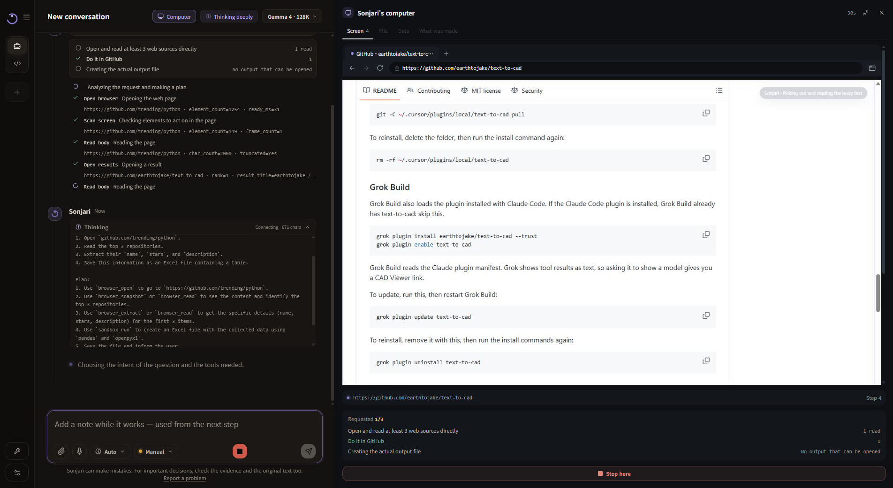
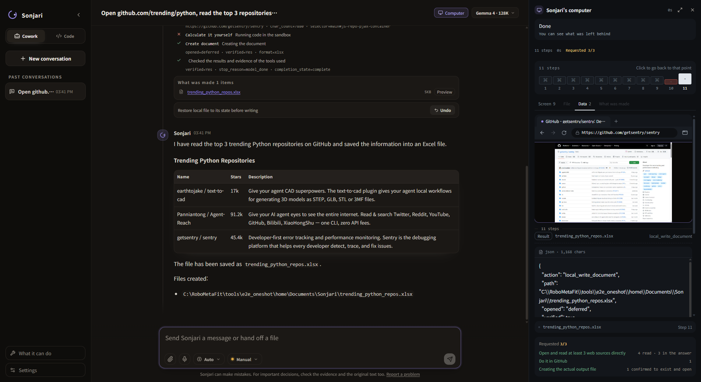
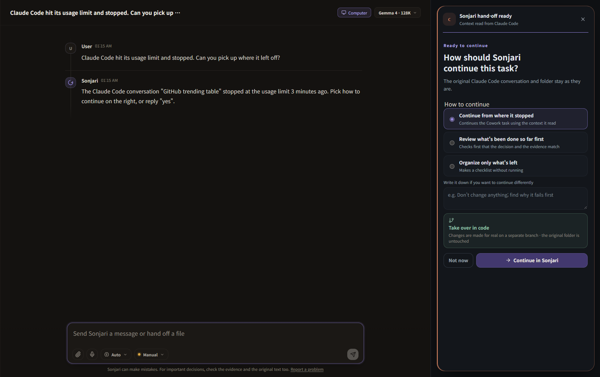

<p align="center">
  
</p>

<h1 align="center">Sonjari (손자리)</h1>

<p align="center">
  <b>Your PC does the work. You get the proof.</b><br>
  It works right in front of you, in your own Chrome and your own files — and leaves the proof.<br>
  A free local AI agent for Windows: it researches the web, builds Excel and Word files, and reads and fixes code —<br>
  on its own, or as the hands for Claude Code, Codex and Cursor. No subscription, no usage meter.
</p>

<p align="center">
  <a href="LICENSE"></a>
  
  <a href="https://apps.microsoft.com/detail/9N458V8HPTR2"></a>
  
</p>

<p align="center">
  <a href="README.ko.md">한국어</a> ·
  <a href="https://sonjari.com">sonjari.com</a> ·
  <a href="CONTRIBUTING.md">Contributing</a> ·
  <a href="https://github.com/sonjari/sonjari/discussions">Discussions</a> ·
  <a href="SECURITY.md">Security</a>
</p>

---

## See it work

**On its own.** One sentence in, an Excel file out. Sonjari opens GitHub Trending, reads the top three Python
repositories and saves name, stars and description as a table. Shown at about 9x; the real run took 2 min 46 s on an
RTX 3090 with Qwen3.8 27B.

https://github.com/user-attachments/assets/91763b31-fe72-4614-b574-b3457ef0518c

**With Claude Code.** Claude Code hands the research to Sonjari over MCP. Sonjari reads the release page on this PC and
only the answer, its source and a short receipt go back to Claude. Claude then checks it: in this run it flags that the
top entry is a release candidate and that Sonjari saved a Word file nobody asked for. Shown at 4x.

https://github.com/user-attachments/assets/415a77b1-6126-45cb-afd3-88bf71ddbea9

**First run.** Setup looks at this PC, picks a model that fits, runs it once to check, and connects Claude Code, Codex
or Cursor. Each step is held for 3 seconds.

https://github.com/user-attachments/assets/c6dd2281-8981-404d-9222-d9f1534f79bc

## Documentation

| I want to … | Read |
|---|---|
| see how the maintainers use it day to day — research and coding with Claude Code, with real numbers | [How we use it](docs/guide/workflows.md) |
| use Sonjari from Claude Code, Codex or Cursor — connect, the three tools, what comes back, code jobs | [MCP guide](docs/guide/mcp.md) |
| know exactly what leaves my PC when another AI uses Sonjari | [What leaves your PC](docs/guide/privacy.md) |
| understand which model I got and what to do if it does not fit | [How Sonjari picks a model](docs/guide/models.md) |
| add know-how or a whole field — skills, skill packs anyone can write, domain packs | [Skills and packs](docs/guide/packs.md) |
| build from source and run the tests | [Developing](#developing) · [Contributing](CONTRIBUTING.md) |


## What it does

- **Proof you can check.** Every run leaves its steps, the pages it read and where each value came from. A number that no
  tool returned is flagged, and a job that did not finish says what it did and where it stopped.
- **Research → file.** Hand it one sentence — *"Open github.com/trending/python, read the top 3 repositories, and save a table
  of name, stars and description as an Excel file"* — and it opens the pages itself, reads them, and writes the table and the file.
- **You can watch it.** "Sonjari's computer" shows the page it is on and how much of the request is done. Add a note mid-task
  to change direction.
- **Your browser, your logins.** It works in a Chrome profile on your PC. When a page needs a login, a CAPTCHA or payment
  details, it stops and hands the screen to you.
- **The hands for your AI.** Claude Code, Claude Desktop, Codex and Cursor can hand it whole tasks over MCP (`sonjari_task`).
  The pages it reads stay on your PC; only the result goes back into the host's context, with a one-line receipt of which
  requested items were filled and what was masked (personal numbers, emails, keys).
- **Picks up where Claude Code stopped.** When Claude Code stops at a usage limit, Sonjari finds how far it got from the
  records left on this PC and asks how to continue. Code changes go to a separate branch; the original folder is not touched.
- **Documents on this PC.** Reads and writes docx / xlsx / pptx / hwpx / pdf inside folders you allow.

<p align="center">
  
  
</p>

## Install

**Use it** — [Microsoft Store](https://apps.microsoft.com/detail/9N458V8HPTR2) (free, updates itself).

| You need | |
|---|---|
| Windows | 10 (19041) or later, x64 |
| GPU | NVIDIA (see the table below) |
| [Ollama](https://ollama.com) | the first-run wizard offers to install it |
| Chrome | for browser tasks |

| Your graphics card | What Sonjari recommends |
|---|---|
| RTX 3090 · 4090 · 5090 (24 GB or more) | the largest model (27B) |
| RTX 4060 Ti 16GB · 4070 Ti Super · 4080 · 5070 Ti · 5080 (16 GB) | a compressed build of the same model |
| RTX 3060 12GB · 4070 · 5070 (12 GB) | the mid-size model (9B) |
| RTX 3060 Ti · 3070 · 4060 · laptop 4060 · 5050 (8 GB) | the mid-size model (9B), compressed, text only (no picture reading) |
| laptop 3050 · 4050 (6 GB) | the small model (4B), compressed, text only — weak; best shared with the AI you already use |

On first launch the wizard measures this PC, recommends one and downloads it (several GB). You do not need to know your
card's name — or pick any Hugging Face GGUF that fits. How far a small card gets is written out under "What we measured" below.

**Connect your AI** — press *Connect* in the app. It adds the `sonjari_task` MCP entry to Claude Code, Claude Desktop, Codex or
Cursor and backs up the original config first. Setting it up by hand, the tools and what comes back: [MCP guide](docs/guide/mcp.md).

**Build from source**

```powershell
powershell -NoProfile -ExecutionPolicy Bypass -File scripts\install.ps1
.venv\Scripts\python.exe -m alture_jarvis
```

## What we measured — and where it falls short

We publish the runs that went badly too. These are small numbers; read them as that.

| Setup (fresh profile, store build) | Task | Result |
|---|---|---|
| Recommended 24 GB model | 5 different research → file tasks, one run each | 5 of 5 finished, 27–93 s |
| 12 GB-class model (9B) | GitHub trending top 3 → Excel | 7 of 7 runs finished, 38–65 s |
| 12 GB-class model (9B) | arXiv latest 3 → comparison table | 4 of 4 |
| 12 GB-class model (9B) | A Korean bookstore, 3 books → Excel | 3 of 3 |

In none of those runs did it report an unfinished job as finished.

### The same price task, on real cards

Visit three shops (Danawa, 11st, Gmarket), find the same product, and write name, price, shipping and the product-page
address into an Excel file. A row counts only if the value is on the page Sonjari actually read. Three products a round.

| Card · model | Rounds | Whole rows | Time per task |
|---|---|---|---|
| RTX 3090 24 GB · 27B | 3 | 26 of 27 | about 6 minutes (median) |
| RTX 5050 Laptop 8 GB · 9B, compressed, text only | 7 | 37 of 63 | about 7.5 minutes |
| RTX 3050 Laptop 6 GB · 4B, compressed, text only | 7 | 10 of 63 — weak (before a memory-leak fix) | — |

With picture reading on, neither small model fully fit on its card, which is why small cards default to text only. If you
send what you measure on your card, this table gets filled in — see [Contributing](CONTRIBUTING.md), door 1.

### With Claude Code — same task, clean setup

Claude Code (`claude-sonnet-5`) drove all four arms, each run in a clean folder with no instruction files above it. Sonjari
ran the 27B on an RTX 3090. 3 products × 3 rounds = 27 rows per arm.

| Arm | Whole rows | Claude cost per whole row | Median time per task |
|---|---|---|---|
| Claude Code + Sonjari's browser tools | 17–23 of 27 | $0.074–0.100 | 401 s |
| Claude Code hands the whole task to Sonjari | 15–18 of 27 | $0.075–0.090 | 391 s |
| Claude Code alone (web fetch and search) | 15 of 27 | $0.246 | 96 s |
| Claude Code + Playwright MCP | 11 of 27 | $0.635 | 162 s |

- The two Sonjari arms are shown as a range because some of their rows were graded by hand (6 for the browser tools,
  3 for the handoff). Automatic grading alone gives the lower number. Details are in the
  [measurement record](measurements/2026-10-19-head-to-head/README.md).
- Counting only automatically graded rows, no difference in correct rows is clear at this size: Sonjari's tools vs
  Playwright 10 vs 4 (sign test p = 0.18), vs Claude alone 7 vs 5 (p = 0.77). With the hand-graded rows the same pairs
  are 13 vs 1 (p = 0.0018) and 9 vs 1 (p = 0.022). An earlier version of this page quoted only the second set.
- It is slow: 6–7 minutes a task against about 1.5 for Claude alone.
- The handoff arm missed 9 rows counting the hand-graded ones (12 by the automatic grader alone; the extra 3 are hand-graded rows
  the saved files cannot confirm). 6 of the 9 were the agent waiting for an approval nobody was there to give; 3 were one shop page that
  never finished loading. Playwright lost most of its rows to one shop's bot block.
- Our own grader was wrong several times while we built this; each fix was re-run over every past row. Three of the 36
  cells were confirmed by hand, because the pages Sonjari had read were no longer stored at the time.

### Driving desktop apps through their own windows

Ten everyday jobs in ten apps (Notepad, Calculator, Paint, Excel, Word, PowerPoint, Hangul → PDF, File Explorer, VS Code,
Task Manager), each done through the app's own window, three runs each. A run passes only if the output is really there
(the file with the right content, or the right value), the window was actually operated, and the agent did not quietly
write the file with its own tool instead. 27B on an RTX 3090; approvals were auto-passed for the test.

| | Passed |
|---|---|
| Before the fixes (one run per app) | 5 of 10 |
| After the fixes (three runs per app) | 30 of 30 |

It is slow: about 1.5–3 minutes for Notepad, Calculator, Paint, File Explorer, Hangul and VS Code, 3.5–8 for Word and
PowerPoint, 5–10 for Excel, where a person needs under a minute. In normal use Sonjari writes
files directly and only drives a window when nothing else reaches. What broke and what changed:
[measurements/2026-10-17-desktop-apps](measurements/2026-10-17-desktop-apps/README.md).

### Coding on outside exercises

12 of the 34 Python exercises in the [Aider polyglot benchmark](https://github.com/Aider-AI/polyglot-benchmark), done by
Sonjari in code mode. One run per exercise, 64K window, 600-second cap, RTX 3090. The model never sees the reference
solution, and the tests are put back to the original before grading.

| Model | Passed | Median time per run |
|---|---|---|
| Swift 1.5 (Qwen3.8 27B), IQ3_S + MTP — recommended for 24 GB | 12 of 12 | 119 s |
| Qwen3.8 27B, same compression without the Swift finetune | 11 of 12 | 251 s |
| Ornith 1.5 35B-A3B, IQ4_XS | 9 of 12 | 136 s |
| Qwen3.5 9B, Q4_K_M (12 GB class), two rounds | 5 of 12 both times | 135 s / 485 s |

Not comparable with Aider's leaderboard (225 exercises, six languages, two tries). Every exercise, the runs that hit the cap,
and one 16 GB-class candidate: [measurements/2026-10-08-coding](measurements/2026-10-08-coding/README.md).

Where it falls short:

- **On a small card, long research gets about halfway.** Comparing across several shops tends to lose one or two of them.
  Finding one place, reading it and writing a document works.
- **Left alone, it can stop and wait for you.** If a task asks it to save a file outside the folders it may write to, it waits
  for your approval in the app. That is on purpose, but an unattended run sits there until you answer.
- **A wrong number can still land in a table.** One of the seven 9B runs wrote 8,000 where the page said 91.2k stars. The number
  was on the page (a different column), so the evidence check could not catch it. Check what matters against the sources it shows.
- **Fiddly page controls fail often.** Autocomplete boxes, date pickers and cookie overlays are where it breaks. On Online-Mind2Web
  (official setup, our own grading, 12 to 15 tasks a round, three rounds) it finished between a third and a half; 6 of 9 failures in
  the first round were this kind. Reading pages and writing a file is the part that works.
- **Times above are from an RTX 3090.** A real 12 GB card is slower. A local model is slower than cloud AI in general.
- **Takeover:** finding the stopped session is measured; how often it then *finishes* the job is not. It is listed as "takes over",
  not "finishes".
- **Windows and NVIDIA only.** No macOS, Linux or AMD/Intel GPU builds yet.

## Principles

- **Local first.** The backend listens on `127.0.0.1` only. Conversations and files stay on the PC — the one exception is a
  problem report you choose to send, and it shows you exactly what will be sent first.
- **No meter.** The model runs on your hardware; there is no per-token charge from us.
- **Honest results.** Numbers that no tool actually returned are flagged instead of presented as facts. A job that did not
  finish says what it did and where it stopped.
- **Irreversible actions need you.** Sending mail, publishing, paying and deleting wait for an approval card in the app
  window. They cannot be approved from an outside AI.

## Why we built it

What do you use your subagents for?

Your main agent wants to take on most of your work. A subagent should take the part that is tedious and expensive: clicking
through a booking site, reading twenty pages, filling in a form. In most setups that part still runs on the same paid model and
the same usage limit.

So we built Sonjari to take that part off it. It runs on your own GPU, in your own browser. It is a full agent first, because it
has to work well on its own before it is worth handing anything to: it does web research, Excel, Word and Hangul documents, and
code by itself. Claude Code, Codex or Cursor can also hand it a task over MCP and get back only the answer, its sources and a
short receipt.

It acts, not just reads. It will take a booking up to the pay button and stop there. You press it.

It is not as smart as your main agent, and it is built not to pretend otherwise. Every result says where it looked, so you or
your main agent can check it.

We did not wrap an existing agent framework. The browser hands, the checks and the receipts were built for this from the start.

## Contributing

> **Whatever your work is, your field experience is Sonjari's teacher.**
> Every failure you report becomes a test Sonjari must pass, forever.

That is already how it is built: tests are named after the day a real run failed — `test_an_unresponsive_runner_is_asked_once_more_1015`
is a 6 GB laptop that lost a task one night in October.

Five ways in, easiest first — details in [CONTRIBUTING.md](CONTRIBUTING.md):

1. **Measure it on your graphics card.** One command; it produces a file with numbers only. This is what we lack most.
2. **Fix one site.** If Sonjari reads the wrong links on a site you use, a two-line JSON file in `recipes/result_links/`
   usually fixes it. No Python needed.
3. **Report a run that went wrong.** Use *Report a problem* in the app, or open an issue with what you asked and what happened.
4. **A text-only skill pack.** A bundle of notes on "this kind of job is done like this". Packs that carry tools are not
   accepted yet — see why in CONTRIBUTING.
5. **Code.** Core parts included. Attach one test — we do the measuring.

The door is wide for now. As more people arrive, changes to the core will move to "talk first, then send".

## Developing

```powershell
.venv\Scripts\python.exe -m pytest tests -q -p no:cacheprovider
cd ui; npm ci; npm run build
```

Copy `.env.example` to `.env` only if you need to change a default. Never commit `.env`, `data/`, OAuth tokens or browser
profiles. Internal names (`alture_jarvis` package, `JARVIS_*` variables, `X-JARVIS-TOKEN` header) come from the project's
earlier name and are kept so existing installs keep working.

## How this is built

Sonjari is maintained by two people, so replies can be slow. Much of the code is written with Claude (Anthropic) as a coding
collaborator — commits carry a `Co-Authored-By` line — and every change is run, checked and released by the maintainers.

## License

Apache License 2.0 — see [LICENSE](LICENSE) and [NOTICE](NOTICE).
Third-party components keep their own licenses; see `packaging/THIRD_PARTY_NOTICES.md`.
The optional camera module uses Ultralytics YOLO (AGPL-3.0); it is **not** installed by default.
"Sonjari", "손자리" and the Sonjari logo are trademarks. The license covers the code, not the name or logo
(Apache-2.0, section 6). Forks are welcome under a different name.
