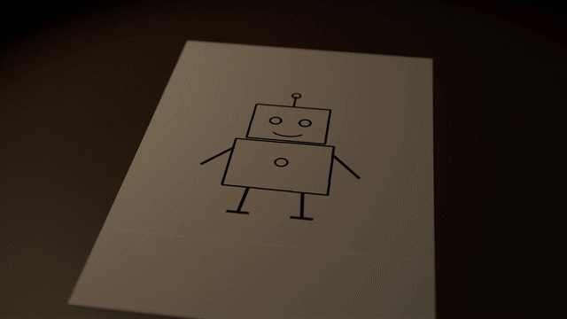
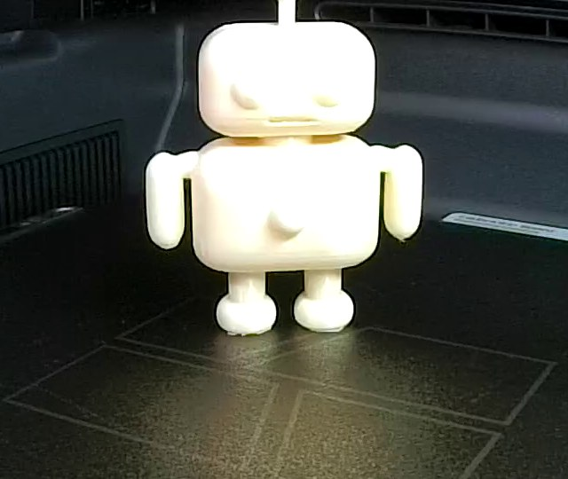
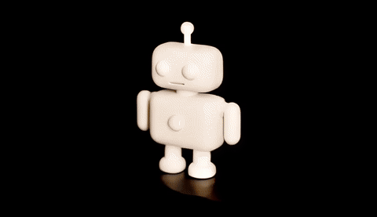
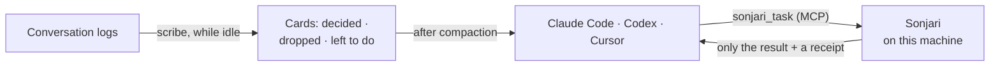
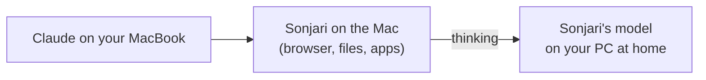

<h1 align="center">Sonjari (손자리)</h1>

<p align="center">
  <b>A free local AI agent for Windows and Mac that Claude hands work to.</b><br>
  It does the work in your own Chrome, files and graphics card, and sends back the result with where it looked.
</p>

<p align="center">
  <a href="LICENSE"></a>
  
  
  <a href="https://apps.microsoft.com/detail/9N458V8HPTR2"></a>
  <a href="https://github.com/sonjari/sonjari/releases/latest"></a>
  <a href="https://glama.ai/mcp/servers/sonjari/sonjari"></a>
</p>

<p align="center">
  <a href="README.ko.md">한국어</a> ·
  <a href="https://sonjari.com">sonjari.com</a> ·
  <a href="#install">Install</a> ·
  <a href="#packs-it-makes-things-too">Packs</a> ·
  <a href="docs/guide/measurements.md">What we measured</a>
</p>

---

Claude Code hands a research job to Sonjari over MCP. Sonjari reads the pages on this PC, and only the answer, its source
and a short receipt go back to Claude. Shown at 4x.

https://github.com/user-attachments/assets/415a77b1-6126-45cb-afd3-88bf71ddbea9

## What it does

Your AI keeps the thinking. Sonjari takes the slow, expensive part and does it on your own machine.

<table>
<tr><td><b>Takes work from Claude, Codex or Cursor</b></td><td>One MCP call hands over a whole job. Pages are read on your machine, so your AI's context and usage limit are spared. <a href="docs/guide/mcp.md">MCP guide</a></td></tr>
<tr><td><b>Works in your logged-in Chrome</b></td><td>Opens, clicks and reads sites as you, and you can watch and step in. It stops at login, CAPTCHA and payment and hands the screen to you. <a href="docs/guide/browser.md">Browser</a></td></tr>
<tr><td><b>Makes things on your graphics card</b></td><td>Packs add 3D models and print files, video drafts and a Unity editor link. Off until Claude asks to turn one on. <a href="#packs-it-makes-things-too">Packs</a></td></tr>
<tr><td><b>Leaves a receipt</b></td><td>Every run keeps its steps, the pages it read and where each value came from. Numbers no tool returned are flagged. <a href="#why-you-can-check-it">Why you can check it</a></td></tr>
<tr><td><b>Takes orders from your phone</b></td><td>Message your own Discord bot; the PC at home does the job. Approvals stay on the PC. <a href="docs/guide/remote.md">Discord</a></td></tr>
</table>

On its own it works too. One sentence in, an Excel file out: Sonjari opens GitHub Trending, reads the top three Python
repositories and saves name, stars and description as a table. Shown at about 9x; the real run took 2 min 46 s on an RTX 3090.

https://github.com/user-attachments/assets/91763b31-fe72-4614-b574-b3457ef0518c

## Install

Two minutes, then one button connects it to the AI you already use.

| | |
|---|---|
| **Windows** | [Microsoft Store](https://apps.microsoft.com/detail/9N458V8HPTR2) — free, updates itself |
| **Mac** (Apple Silicon, macOS 13+) | [Download the .dmg](https://github.com/sonjari/sonjari/releases/latest) — signed and notarized by Apple |
| **Connect to Claude** | Press **Connect** in the app (Claude Code, Claude Desktop, Codex, Cursor). By hand: [MCP guide](docs/guide/mcp.md) |

On first launch the wizard measures the machine, picks a model that fits, downloads it and runs it once.
Have a Windows PC at home and a Mac on the go? Pair them, and the Mac uses the PC's graphics card.

## Packs: it makes things, too

Beyond the browser, packs let Claude plan something and Sonjari build it on your graphics card. Left: how it goes.
Right: what actually came out.

<table>
<tr>
<td width="60%"><a href="https://www.youtube.com/watch?v=cAqdbsfF9Bk"></a></td>
<td width="40%"></td>
</tr>
<tr><td colspan="2"><b>3D pack</b> — one drawing to a 3D model, then a print file. 130–143 s on an RTX 3060 12GB (same drawing, 3 runs); printed in one piece, 100 mm. <a href="docs/guide/packs.md#3d-pack">How it works</a></td></tr>
<tr>
<td></td>
<td></td>
</tr>
<tr><td colspan="2"><b>Video pack</b> — Claude writes the storyboard, Sonjari renders draft cuts and checks each one. This 3-second cut: 40.5 s on an RTX 3090; 31–57 s per cut on an RTX 3060 12GB (4 runs). AI-generated · Windows. <a href="docs/guide/packs.md#video-pack">How it works</a></td></tr>
</table>

▶ The whole 47-second film: https://www.youtube.com/watch?v=cAqdbsfF9Bk

| Pack | What it does | Windows | Mac | Tested on |
|---|---|:---:|:---:|---|
| [3D](docs/guide/packs.md#3d-pack) | drawing → 3D model (GLB) → print file (STL · 3MF); Blender clean-up | ✅ | ✅ | RTX 3060 12GB · 16 GB Mac (512 only) |
| [Video](docs/guide/packs.md#video-pack) | storyboard → draft cuts, each checked (still · too dark · broken frames · sound) | ✅ | — | RTX 3060 12GB |
| [Unity](packs/game) | reads and changes an open Unity editor, with undo | ✅ | ✅ | Unity |
| [Video reading](packs/video) | reads a reference video scene by scene into a table | ✅ | ✅ | — |

From 0.4.49 on, the 3D and video packs are under [PolyForm Noncommercial](https://polyformproject.org/licenses/noncommercial/1.0.0) or [PolyForm Small Business](https://polyformproject.org/licenses/small-business/1.0.0) 1.0.0,
your pick: free for personal and noncommercial use, and for companies with fewer than 100 people and less than US$1M revenue a year
(2019 dollars, inflation-adjusted). Larger companies: [get in touch](https://github.com/sonjari/sonjari/discussions). The app and the other packs stay Apache-2.0.

## Why it is built as a subagent

So why hand work to another agent at all, instead of giving your AI more tools?

Your main agent should do the thinking. A subagent should take the part that is tedious and expensive: clicking through a
site, reading twenty pages, rendering a model. In most setups that part still runs on the same paid model and the same
usage limit.



**Why an agent, not a set of tools.** If Sonjari were only browser tools for your AI, your AI would still pay to read every
page through its own context. So Sonjari does the whole job on your hardware and sends back only the result.

Same price task, Claude Code (`claude-sonnet-5`) in charge, 27 rows per way:

| How Claude got the pages | Claude cost per complete row |
|---|---|
| A general browser tool (Playwright MCP) | $0.635 |
| Claude alone (web fetch and search) | $0.246 |
| Sonjari's browser tools, driven by Claude | $0.074–0.100 |
| The whole task handed to Sonjari | $0.075–0.090 |

Small numbers, some rows graded by hand, and slower: 6–7 minutes a task against about 1.5 for Claude alone.
Every caveat: [What we measured](docs/guide/measurements.md#with-claude-code--same-task-clean-setup).

- **Picks up where Claude Code stopped at a usage limit.** It finds which conversation stopped and how far it got.
- **Keeps what you decided, even after compaction.** The scribe writes cards — decided, dropped, left to do — each with a quote. Off by default.

## Will it run on my machine?

It picks a model for your hardware on first launch. Here is what it usually lands on.

| Your machine | What Sonjari recommends |
|---|---|
| RTX 3090 · 4090 · 5090 (24 GB or more) | the largest model (27B) |
| 16 GB cards (4060 Ti 16GB · 4070 Ti Super · 4080 · 5070 Ti · 5080) | a compressed build of the same model |
| 12 GB cards (3060 12GB · 4070 · 5070) | the mid-size model (9B) |
| 8 GB cards | 9B, compressed, text only |
| 6 GB laptops | 4B, compressed, text only — weak; best shared with the AI you already use |
| **Mac, 16 GB, on its own** | 9B, compressed, text only. The first question takes about two minutes; after that about ten seconds |
| **Mac paired with your PC** | the PC's model, on the PC's graphics card |



## Why you can check it

- **It shows where it looked.** Every run leaves its steps, the pages it read and where each value came from.
- **It flags what it cannot back up.** A number no tool returned is marked, and a job that did not finish says where it stopped.
- **You press the irreversible buttons.** Sending, publishing, paying and deleting wait for an approval card in the app.

Every number we have, including the runs that went badly: [What we measured](docs/guide/measurements.md).

**Good to know (Mac):** on a Mac on its own, the first question takes about two minutes while the model reads its tools
and instructions for the first time; after that, about ten seconds. Long web research on a 16 GB Mac takes minutes; pair it
with your PC and the PC's graphics card does it. The video pack is Windows only.

## What's next

| | Where it is |
|---|---|
| Big models on small cards: experts in RAM, so a 6 GB laptop can run a 35B model | part shipped (RAM boost) · measuring |
| Mac: a fast first question, warmed up right after the model downloads | designing |
| Mac: send 3D and video jobs to your PC at home | designing |
| Blender workbench: render, auto-rig, export to Unity | designing |
| AMD graphics cards | later |

Want one sooner? Say so in [Discussions](https://github.com/sonjari/sonjari/discussions).

## Read more

| I want to … | Read |
|---|---|
| see how the maintainers use it day to day, with real numbers | [How we use it](docs/guide/workflows.md) |
| use Sonjari from Claude Code, Codex or Cursor | [MCP guide](docs/guide/mcp.md) |
| know exactly what leaves my PC when another AI uses Sonjari | [What leaves your PC](docs/guide/privacy.md) |
| understand which model I got and what to do if it does not fit | [How Sonjari picks a model](docs/guide/models.md) |
| add know-how or a whole field — skills, skill packs, domain packs (games, video) | [Skills and packs](docs/guide/packs.md) |
| see every measurement and its limits | [What we measured](docs/guide/measurements.md) |
| read the rules it keeps — local first, no meter, honest results, you press the irreversible buttons | [Principles](docs/why.md) |

## Documentation

| I want to … | Read |
|---|---|
| see how the maintainers use it day to day, with real numbers | [How we use it](docs/guide/workflows.md) |
| use Sonjari from Claude Code, Codex or Cursor | [MCP guide](docs/guide/mcp.md) |
| know exactly what leaves my PC when another AI uses Sonjari | [What leaves your PC](docs/guide/privacy.md) |
| understand which model I got and what to do if it does not fit | [How Sonjari picks a model](docs/guide/models.md) |
| add know-how or a whole field — skills, skill packs, domain packs (games, video) | [Skills and packs](docs/guide/packs.md) |
| see every measurement and its limits | [What we measured](docs/guide/measurements.md) |
| read the rules it keeps — local first, no meter, honest results, you press the irreversible buttons | [Principles](docs/why.md) |

## Contributing

> **Whatever your work is, your field experience is Sonjari's teacher.**
> Every failure you report becomes a test Sonjari must pass, forever.

Measure it on your card, fix one site with a two-line JSON file, report a run that went wrong, write a text-only skill
pack, or send code with one test. Details: [CONTRIBUTING.md](CONTRIBUTING.md).

## Developing

```powershell
powershell -NoProfile -ExecutionPolicy Bypass -File scripts\install.ps1
.venv\Scripts\python.exe -m alture_jarvis
.venv\Scripts\python.exe -m pytest tests -q -p no:cacheprovider
cd ui; npm ci; npm run build
```

Copy `.env.example` to `.env` only if you need to change a default. Never commit `.env`, `data/`, OAuth tokens or browser
profiles. Internal names (`alture_jarvis` package, `JARVIS_*` variables, `X-JARVIS-TOKEN` header) come from the project's
earlier name and are kept so existing installs keep working.

Sonjari is maintained by two people, so replies can be slow. Much of the code is written with Claude (Anthropic) as a coding
collaborator — commits carry a `Co-Authored-By` line — and every change is run, checked and released by the maintainers.

## License

Apache License 2.0 — see [LICENSE](LICENSE) and [NOTICE](NOTICE).
Third-party components keep their own licenses; see `packaging/THIRD_PARTY_NOTICES.md`.
The optional camera module uses Ultralytics YOLO (AGPL-3.0); it is **not** installed by default.
"Sonjari", "손자리" and the Sonjari logo are trademarks. The license covers the code, not the name or logo
(Apache-2.0, section 6). Forks are welcome under a different name.
