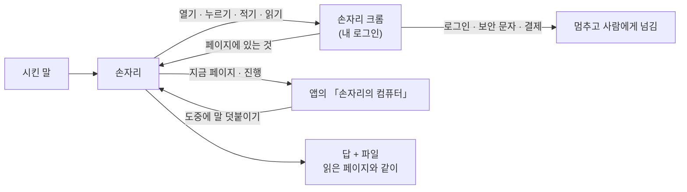

# 내 브라우저에서

[English](browser.md) · **한국어**

손자리는 이 PC 의 크롬 프로필에서, 거기서 해 둔 로그인 그대로 일합니다. 여는 페이지를 전부 볼 수 있고 언제든 끼어들 수 있습니다.

## 보이는 것

- **「손자리의 컴퓨터」** 에 지금 보는 페이지와 시킨 일이 얼마나 됐는지가 나옵니다. 도중에 말을 덧붙여 방향을 바꿀 수 있습니다.
- 판마다 걸음, 읽은 페이지, 값마다 어디서 왔는지가 남습니다.

## 멈추는 곳

- **로그인 · 보안 문자 · 결제 정보:** 멈추고 화면을 사람에게 넘깁니다. 본문이 다 보이는 페이지는
  아래에 보안 문자 상자가 있다는 것만으로 막혔다고 보지 않습니다.
- **되돌릴 수 없는 일**(보내기 · 올리기 · 결제 · 지우기)은 앱의 승인 카드를 기다립니다.
- 예약은 결제 단추 바로 앞까지 갑니다. 누르는 건 사람입니다.

## 잘 안 되는 곳

자동 완성 칸, 날짜 고르기, 쿠키 안내 창에서 가장 자주 틀립니다. 페이지를 읽고 파일로 쓰는 일이 잘 되는 쪽입니다.
숫자는 [잰 것](measurements.ko.md)에 있습니다.

크롬이 없으면 엣지로 붙습니다.
