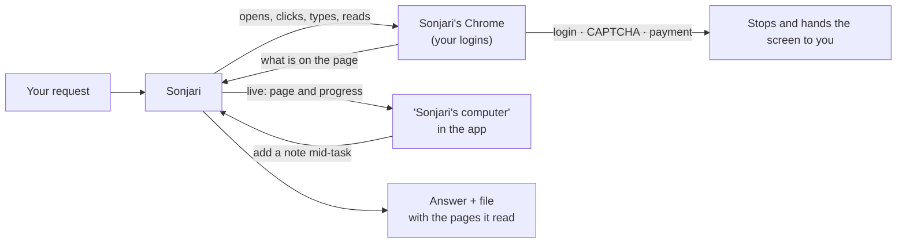

# Your own browser

**English** · [한국어](browser.ko.md)

Sonjari works in a Chrome profile on your PC — with the logins you made there. You can watch every page it opens and step
in at any time.

## What you see

- **"Sonjari's computer"** shows the page it is on and how much of the request is done. Add a note mid-task to change
  direction.
- Every run leaves its steps, the pages it read and where each value came from.

## Where it stops

- **Login, CAPTCHA, payment details:** it stops and hands the screen to you. A page whose text
  is fully readable is not treated as blocked just because a CAPTCHA box sits underneath it.
- **Irreversible actions** — sending, publishing, paying, deleting — wait for an approval card in the app.
- It can take a booking up to the pay button. You press it.

## Where it struggles

Autocomplete boxes, date pickers and cookie overlays are where it breaks most often. Reading pages and writing a file is
the part that works. Numbers: [What we measured](measurements.md).

If Chrome is not installed, it uses Edge.
