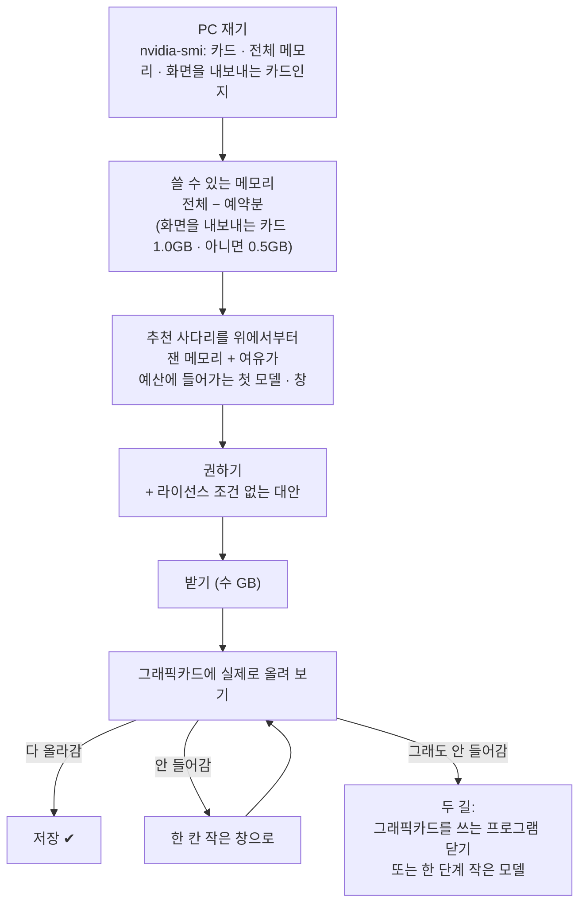

# 손자리가 내 PC 에 맞는 모델을 고르는 방식

[English](models.md) · **한국어**

내 그래픽카드 이름을 몰라도 괜찮습니다. 처음 켜면 마법사가 카드를 재고, 모델 하나를 추천하고, 내려받은 다음 실제로 그래픽카드에
올려 봅니다. 저장은 그게 성공한 뒤에 합니다. 이 문서에는 왜 그 모델이 골라졌는지, 안 들어가면 어떻게 하면 되는지를 적었습니다.

## 고르는 순서

추천에 쓰는 메모리 숫자는 파일 크기를 보고 짐작한 게 아니라 저희가 직접 올려 보고 잰 값입니다. 그리고 마지막 판단은 언제나 내
카드에 실제로 올려 본 결과를 따릅니다.

## 카드별로 받게 되는 모델

| 그래픽 메모리 | 처음 추천 | 창 | 그림 읽기 |
|---|---|---|---|
| 24GB 이상 (RTX 3090, 4090, 5090) | Qwen3.8 27B 「Swift」 | 128K | 켜짐 |
| 16GB (4060 Ti 16GB, 4070 Ti Super, 4080, 5070 Ti, 5080) | 같은 27B 의 작은 판 (3비트) | 64K | 꺼짐 (글만 읽음) |
| 12GB (3060 12GB, 4070, 5070) | Qwen3.5 9B | 128K | 켜짐 |
| 8GB (3060 Ti, 3070, 4060, 노트북 4060, 5050) | Qwen3.5 9B 3비트 | 48K | 꺼짐 |
| 6GB (노트북 3050, 4050) | Qwen3.5 4B 3비트 | 48K | 꺼짐. 혼자 쓰기엔 약해서, 이미 쓰는 AI 와 같이 쓰기를 권합니다 |

작은 카드에서 그림 읽기를 끄는 데는 이유가 있습니다. 그림 읽는 부품을 떼면 메모리가 1GB 쯤 비고, 그만큼 창을 넓힐 수 있습니다.
16GB 카드에서 재 보니 글만 읽는 64K 가 그림을 읽는 48K 보다 메모리를 덜 쓰면서 가격 조사 결과도 더 좋았습니다. 대신 붙인 사진,
그림으로 된 글, 손자리가 만든 화면을 눈으로 확인하는 일은 못 합니다. 필요하면 **설정 › 모델**에서 다시 켤 수 있고, 대화창에
「그림 읽기 켜 줘」라고 해도 됩니다.

## 모델이 안 들어갈 때

그래픽 메모리는 다른 프로그램과 같이 씁니다. 3D 프로그램(3ds Max, Blender), 게임, 영상 편집기가 몇 GB 를 차지하고 있으면,
원래는 27B 가 들어가는 카드여도 그 프로그램을 켜 둔 동안에는 안 들어갈 수 있습니다. 이럴 때 마법사가 두 가지 방법을 보여 줍니다.

1. **닫기.** 지금 그래픽카드를 쓰고 있는 프로그램 목록과, 그걸 닫으면 들어가는지를 보여 줍니다. 저장 안 한 작업이 날아갈 수 있어서
   손자리가 대신 닫지는 않습니다.
2. **작게.** 지금 비어 있는 메모리에 들어가는 한 단계 작은 모델을 권합니다.

그 프로그램을 켜 둔 채로 일하신다면 작은 쪽을 고르시는 게 맞습니다. 모델은 나중에 **설정 › 모델**에서 언제든 바꿀 수 있습니다.

## 내가 고른 모델을 쓸 때

**설정 › 모델**에서 허깅페이스의 GGUF 모델을 직접 고를 수도 있습니다. 이때도 같은 기준으로 들어가는지 보고, 도구를 부를 줄 모르는
모델은 받지 않습니다(손자리는 도구 없이는 일을 못 합니다). 저장 전에 실제로 올려 보는 것도 똑같습니다.

## 지금 쓰는 모델 확인하기

손자리에게 「지금 설정 보여줘」라고 하면 지금 쓰는 모델, 그림 읽기, 창 크기를 바로 알려 줍니다. 이건 모델을 부르지 않고 답합니다.

관련 코드는 `src/alture_jarvis/setup_profile.py`(재기와 추천 사다리), `model_setup.py`(실제로 올려 보기와 두 가지 방법),
`model_catalog.py`(모델과 창 크기별로 잰 메모리, 그리고 그렇게 고른 이유)에 있습니다.
