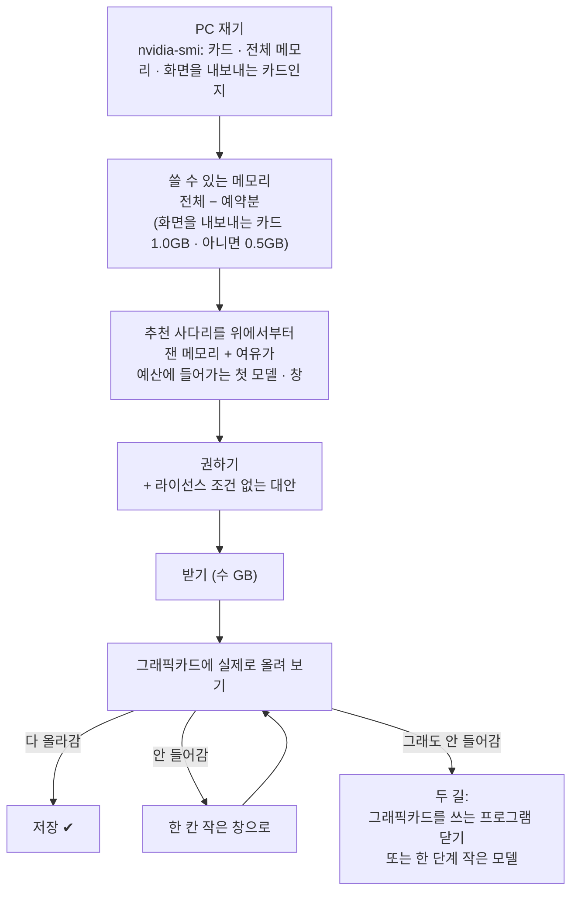

# 손자리는 내 PC 에 맞는 모델을 어떻게 고르나

[English](models.md) · **한국어**

그래픽카드 이름을 몰라도 됩니다. 첫 실행 마법사가 카드를 재고, 모델 하나를 권하고, 받은 뒤 **실제로 올려 보고** 나서야 저장합니다.
이 문서는 단계마다 왜 그 모델이 나왔는지, 안 들어가면 무엇을 하면 되는지 적습니다.

## 단계

사다리의 메모리 숫자는 파일 크기로 짐작한 게 아니라 **잰 값**이고, 마지막 판단은 내 카드에 실제로 올려 본 결과(F)입니다.

## 카드별로 받는 것

| 그래픽 메모리 | 첫 추천 | 창 | 그림 읽기 |
|---|---|---|---|
| 24GB 이상(RTX 3090 · 4090 · 5090) | Qwen3.8 27B 「Swift」 | 128K | 켜짐 |
| 16GB(4060 Ti 16GB · 4070 Ti Super · 4080 · 5070 Ti · 5080) | 같은 27B 의 작은 판(3비트) | 64K | **꺼짐**(글만 읽기) |
| 12GB(3060 12GB · 4070 · 5070) | Qwen3.5 9B | 128K | 켜짐 |
| 8GB(3060 Ti · 3070 · 4060 · 노트북 4060 · 5050) | Qwen3.5 9B 3비트 | 48K | **꺼짐** |
| 6GB(노트북 3050 · 4050) | Qwen3.5 4B 3비트 | 48K | **꺼짐** — 혼자서는 약함, 이미 쓰는 AI 와 같이 쓰는 걸 권함 |

작은 카드에서 「글만 읽기」인 까닭: 그림 부속을 떼면 약 1GB 가 비고, 그 자리로 창을 넓힐 수 있습니다. 16GB 카드에서 글만 읽기
64K 가 그림 있는 48K 보다 메모리를 덜 썼고, 가격 조사 과제 결과도 더 좋았습니다. 내주는 것: 붙인 사진 · 그림으로 된 글 · 만든
화면을 눈으로 보는 검사. **설정 › 모델**에서 그림 읽기를 다시 켤 수 있고, 대화창에 「그림 읽기 켜 줘」라고 해도 됩니다.

## 안 들어갈 때

다른 프로그램도 같은 그래픽 메모리를 씁니다. 3D 프로그램(3ds Max · Blender) · 게임 · 영상 편집기는 몇 GB 를 쥐고 있을 수 있어서,
서류상 27B 가 들어가는 카드도 그 프로그램을 켠 동안에는 안 들어갈 수 있습니다. 그러면 마법사가 두 길을 보여 줍니다.

1. **닫기** — 지금 그래픽카드를 쓰는 프로그램 목록과, 그걸 닫으면 들어가는지. 손자리가 대신 닫지는 않습니다(저장 안 한 작업).
2. **작게** — 지금 비어 있는 메모리에 들어가는 한 단계 작은 모델.

그 프로그램을 켜 둔 채로 일한다면 작은 쪽이 맞는 선택입니다. 모델은 나중에 **설정 › 모델**에서 바꿀 수 있습니다.

## 내가 고른 모델

**설정 › 모델**에서 허깅페이스의 GGUF 아무거나 고를 수 있습니다. 같은 예산으로 들어가는지 보고, 도구를 못 부르는 모델은
받지 않으며(손자리는 도구 없이 일하지 못합니다), 저장하기 전에 실제로 올려 봅니다 — 위와 같습니다.

## 지금 무엇을 쓰는지 보기

손자리에게 「지금 설정 보여줘」라고 하면 모델을 부르지 않고 지금 모델 · 그림 읽기 · 창을 알려 줍니다.

코드: `src/alture_jarvis/setup_profile.py`(재기 · 사다리), `model_setup.py`(올려 보기 · 두 길),
`model_catalog.py`(모델 · 창별 잰 메모리와 고른 까닭).
