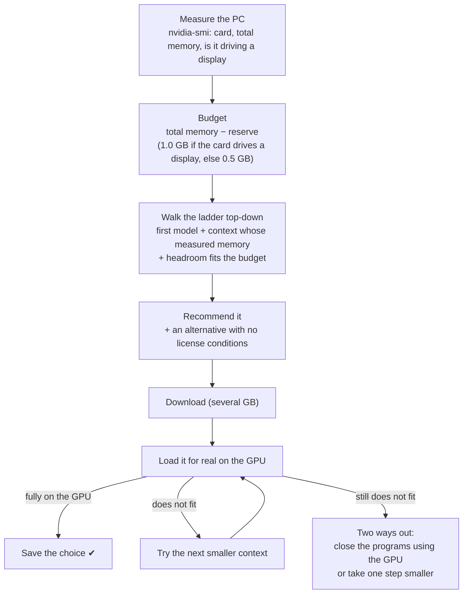

# How Sonjari picks a model for your PC

**English** · [한국어](models.ko.md)

You do not need to know your graphics card. The first-run wizard measures it, recommends one model, downloads it and then
**loads it for real** before saving the choice. This page explains each step so you know why you got what you got — and
what to do if it does not fit.

## The steps

The memory numbers on the ladder were **measured**, not estimated from file size — and the last word is the real load on
your card (step F).

## What you get, by card

| Graphics memory | First recommendation | Context | Picture reading |
|---|---|---|---|
| 24 GB or more (RTX 3090 · 4090 · 5090) | Qwen3.8 27B "Swift" | 128K | on |
| 16 GB (4060 Ti 16GB · 4070 Ti Super · 4080 · 5070 Ti · 5080) | the same 27B, compressed (3-bit) | 64K | **off** (text only) |
| 12 GB (3060 12GB · 4070 · 5070) | Qwen3.5 9B | 128K | on |
| 8 GB (3060 Ti · 3070 · 4060 · laptop 4060 · 5050) | Qwen3.5 9B, 3-bit | 48K | **off** |
| 6 GB (laptop 3050 · 4050) | Qwen3.5 4B, 3-bit | 48K | **off** — weak on its own; best paired with the AI you already use |

Why "text only" on smaller cards: removing the picture part frees about 1 GB, and that room gives a bigger context. On a
16 GB card, text-only 64K used less memory than with-pictures 48K and did better on our price-research tasks. What you give
up: reading attached pictures, pictures that contain text, and visually checking a page it built. You can switch picture
reading back on in **Settings › Model**, or just say "turn picture reading on" in the chat.

## When it does not fit

Other programs share the same graphics memory. A 3D tool (3ds Max, Blender), a game or a video editor can hold several GB,
so a card that fits the 27B on paper may not fit it while those are open. The wizard then shows:

1. **Close** — the programs currently using the card, and whether closing them would make room. Sonjari never closes them
   for you (unsaved work).
2. **Smaller** — the next model that fits the memory that is free right now.

Picking the smaller one is the right call if you keep those programs open while you work. You can change models later in
**Settings › Model**.

## Your own model

You can pick any GGUF from Hugging Face in **Settings › Model**. Sonjari checks it against the same budget, refuses models
that cannot call tools (it cannot work without them), and loads it for real before saving — same as above.

## Check what you have

Ask Sonjari "show my settings" — it answers with the current model, picture reading and context, without calling the model.

The code: `src/alture_jarvis/setup_profile.py` (measuring, the ladder), `model_setup.py` (loading, the two ways out),
`model_catalog.py` (measured memory per model and context, with the reason for each choice).
