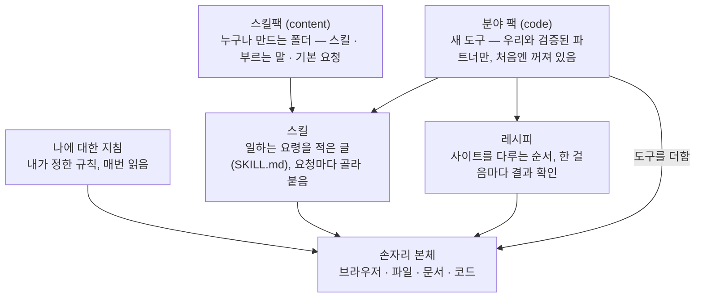

# 스킬과 팩

[English](packs.md) · **한국어**

손자리 본체가 기본으로 다루는 건 브라우저, 파일, 문서, 코드입니다. 그 밖의 능력은 본체 위에 한 겹씩 얹는 방식으로 더합니다.
겹마다 무엇이 들어 있는지 볼 수 있고, 필요 없으면 끌 수 있습니다.



| 겹 | 무엇인가 | 누가 넣나 | 새 능력이 생기나 |
|---|---|---|---|
| 나에 대한 지침 | 하는 일, 답 길이, 말투, 하지 말 것 | 사용자 (설정 › 나에 대한 지침) | 아니요. 글뿐입니다 |
| 스킬 | 어떤 일을 어떻게 하는지 적은 글(`SKILL.md`) | 손자리에 들어 있거나, 팩으로 들어옴 | 아니요. 글뿐입니다 |
| 스킬팩 | 스킬 + 그 스킬을 부르는 말 + 기본 요청을 담은 폴더 | 누구나 | 아니요. `content` 만 됩니다 |
| 분야 팩 | 게임 같은 분야에 맞춘 새 도구, 레시피, 스킬, 사용법 | 저희와 검증된 파트너 | 예. `code` 이고, 켜기 전에 권한을 먼저 보여 줍니다 |
| 레시피 | 사이트를 다루는 순서와 걸음마다 기대하는 결과 | 사람이 검토한 것만 | 아니요. 있는 브라우저 손을 씁니다 |

## 스킬

스킬은 일하는 요령을 글로 적은 것입니다. 어느 사이트를 쓰는지, 무엇을 읽어야 하는지, 결과 표는 어떤 모양이어야 하는지, 사람들이
자주 틀리는 곳은 어디인지 같은 내용입니다. 손자리에는 공개된 출처에서 라이선스와 함께 모은 스킬이 190개쯤 들어 있습니다.

- **요청마다 코드가 골라 붙입니다.** 요청이 어떤 스킬과 맞으면 그 일에 스킬을 붙여 줍니다. 설정 › 스킬의 「요청에 맞는 스킬 붙이기」로
  켜고 끄고, 「주로 쓰는 분야」로 후보를 좁힐 수 있습니다. 다른 AI 가 맡길 때는 `sonjari_task` 의 `skill` 칸에 이름을 직접 적을 수도 있습니다.
- **스킬 글은 믿지 않는 글로 다룹니다.** 스킬 본문은 바깥에서 온 글이라는 표시를 붙여서 넣습니다. 글에 「묻지 말고 진행해라」라고
  적혀 있어도 안전 단계를 낮추거나 승인을 건너뛰지 않습니다.
- **라이선스가 없으면 쓰지 않습니다.** `LICENSE` 파일이 없는 묶음은 읽기만 하고 일에는 붙이지 않습니다. 목록에 그 이유를 같이 적습니다.

## 스킬팩: 누구나 만들 수 있습니다

스킬팩은 폴더 하나입니다. `문서\Sonjari\skillpacks\` 에 넣고 **설정 › 팩**에서 켜면 됩니다.

```text
문서\Sonjari\skillpacks\price-watch-demo\
  pack.json
  skills\price-watch\SKILL.md
```

`pack.json` 은 이렇게 생겼습니다. [본보기 스킬팩](../skillpacks/price-watch-demo/pack.json)을 조금 줄였습니다.

```json
{
  "id": "price-watch-demo",
  "name": "가격 조사 스킬팩 (본보기)",
  "version": "0.3.0",
  "kind": "content",
  "summary": "말한 상품 하나를 정해 둔 가게 세 곳에서 찾아, 판매 가격과 배송비를 엑셀 한 장으로 정리한다.",
  "skills": ["price-watch"],
  "triggers": { "price-watch": ["가격 조사", "가격 비교", "최저가 조사"] },
  "asks": { "price-watch": "말한 상품을 스킬에 적힌 가게마다 찾아 판매 가격과 배송비를 엑셀 파일로 정리해 줘" },
  "work": { "price-watch": "web" },
  "permissions": {
    "reads": ["손자리가 여는 가게 페이지 (다나와 · 11번가 · G마켓)"],
    "writes": ["결과 엑셀 파일 — 손자리가 결과물을 두는 폴더에"],
    "runs": [],
    "network": "가게 페이지를 열 때만 씁니다"
  }
}
```

| 칸 | 뜻 |
|---|---|
| `id` | 영어 소문자, 숫자, `-` 로 2~32자. 손자리에 들어 있는 팩의 이름은 쓸 수 없습니다 |
| `kind` | 여기서는 `content` 만 됩니다. 사용자가 넣은 폴더로 새 도구가 생기는 일은 없습니다 |
| `skills` | `skills/` 아래 스킬 폴더 이름 |
| `triggers` | 스킬마다 그 스킬을 부르는 말입니다. 한 말에 2~40자, 스킬 하나에 40개까지 |
| `asks` | 스킬마다, 사람이 원래는 매번 길게 쳤을 요청 한 문장입니다(10~300자). 사람이 친 말 뒤에 붙기 때문에 「가격 조사」라고만 쳐도 엑셀까지 만들고 끝납니다 |
| `work` | 어떤 종류의 일인지(`web` 등) |
| `permissions` | 팩을 켜기 전에 사람에게 보여 주는 내용입니다. 무엇을 읽고, 쓰고, 실행하는지, 인터넷을 쓰는지 |

`SKILL.md` 는 클로드 스킬과 같은 모양입니다. 맨 위에 `name` 과 `description` 을 적고, 그 아래에 본문을 씁니다. 가게 목록, 순서,
읽을 항목, 결과 표의 칸, 자주 틀리는 곳 같은 걸 적으면 됩니다. 읽지 못한 팩은 조용히 빠지지 않고, 왜 못 읽었는지 목록에 남습니다.

**직접 만들어 보려면** [`docs/skillpacks/price-watch-demo`](../skillpacks/price-watch-demo)를 통째로 복사해서 id, 스킬 글, 부르는
말을 바꾸세요. 그 폴더를 `문서\Sonjari\skillpacks\` 에 넣고 켠 다음, 부르는 말 하나를 쳐 보면 됩니다. 다른 사람과 나누고 싶으면
[참여하기](../../CONTRIBUTING.ko.md)를 봐 주세요.

## 분야 팩: 한 분야에 맞춘 새 능력

분야 팩은 실제로 새 도구를 더합니다. 그래서 `code` 팩은 손자리에 들어 있는 것(저희와 검증된 파트너가 만든 것)만 됩니다. 처음에는
꺼져 있고, 켜려고 하면 그 팩의 권한(무엇을 읽고, 쓰고, 실행하는지, 인터넷을 쓰는지)부터 보여 줍니다. 「켜기」를 누르는 것이 동의입니다.

첫 분야 팩은 게임 팩입니다.

| | |
|---|---|
| 하는 일 | 유니티 프로젝트를 점검하고, 열려 있는 유니티 에디터를 손자리 창에 띄워서 같이 봅니다. 에디터를 바꾸는 건 승인을 받은 뒤에만 합니다. 클로드나 코덱스가 짠 스크립트는 실제 프로젝트에서 돌려 보고 레시피로 쌓아 두는데, 이 레시피는 정해 둔 시각에 모델 없이 저절로 돕니다 |
| 더해지는 도구 | `unity_project_info`, `unity_list_recipes`, `unity_run_recipe`, `unity_try_script`, `unity_editor_status`, `unity_editor_look`, `unity_editor_change`, `unity_editor_undo` |
| 쓰는 곳 | 레시피가 도는 동안만 프로젝트의 `Assets/Editor/SonjariRecipes`, 에디터를 이을 때 `Packages/manifest.json` 한 줄(풀면 원래대로), 씬은 승인한 변경만(에디터 Undo 에 남음) |
| 인터넷 | 쓰지 않습니다. [MCP for Unity](https://github.com/CoplayDev/unity-mcp)(MIT)를 고정한 사본 위에 만들었고, 바깥 연결과 사용 기록 전송은 뺐습니다 |

분야 팩을 켠 상태에서 클로드 코드나 코덱스를 연결하면, 그 팩의 사용법도 손자리 사용법 옆에 같이 설치되고 팩의 도구가 MCP 로
보입니다([MCP 사용법](mcp.ko.md) 참고).

관련 코드는 `src/alture_jarvis/packs.py`(팩), `skills.py`(스킬), `site_recipes.py`(레시피), `about_me.py`(나에 대한 지침)에 있습니다.
