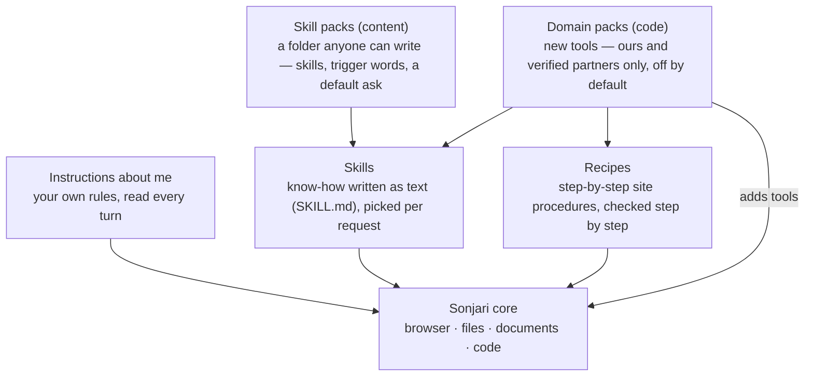

# Skills and packs

**English** · [한국어](packs.ko.md)

Sonjari's core knows the browser, files and documents. Everything else is added on top, in layers you can see and switch
off:



| Layer | What it is | Who can add it | Can it add new abilities? |
|---|---|---|---|
| Instructions about me | your work, answer length, tone, things to avoid | you (Settings › About me) | no — text only |
| Skills | how to do a kind of job, written as a `SKILL.md` | bundled, or through a pack | no — text only |
| Skill packs | a folder of skills + the words that trigger them + a default ask | anyone | no — `content` only |
| Domain packs | new tools, recipes, skills and a guide for a field (games, …) | us and verified partners | yes — `code`, shown with permissions before you turn it on |
| Recipes | site procedures with an expected result after each step | reviewed by people | no — they drive the existing browser |

---

## Skills

A skill is know-how written as text: which sites to use, what to read, how the result table should look, where people
usually go wrong. Sonjari ships about 190 of them, collected from open sources with their licenses.

- **Picked by code, per request.** When a request matches a skill, Sonjari attaches it to that job (Settings › Skills ›
  *Attach a skill that fits the request*, and *Main fields* to narrow the choice). Another AI can name one directly with the
  `skill` field of `sonjari_task`.
- **Treated as untrusted text.** A skill's body is wrapped and marked as outside material. A skill cannot lower a safety
  level or skip an approval, even if its text says so.
- **No license, no serving.** A bundle without a `LICENSE` file is read but not used, and the list says why.

## Skill packs — anyone can make one

A skill pack is a folder. Put it in `Documents\Sonjari\skillpacks\` and turn it on in **Settings › Pack**.

```text
Documents\Sonjari\skillpacks\price-watch-demo\
  pack.json
  skills\price-watch\SKILL.md
```

`pack.json` (the [sample pack](../skillpacks/price-watch-demo/pack.json), shortened):

```json
{
  "id": "price-watch-demo",
  "name": "Price check skill pack (sample)",
  "version": "0.3.0",
  "kind": "content",
  "summary": "Finds one product at three set shops and puts price and shipping into one Excel sheet.",
  "skills": ["price-watch"],
  "triggers": { "price-watch": ["가격 조사", "가격 비교", "최저가 조사"] },
  "asks": { "price-watch": "Find the product at each shop in the skill and put price and shipping into an Excel file" },
  "work": { "price-watch": "web" },
  "permissions": {
    "reads": ["the shop pages Sonjari opens"],
    "writes": ["the result Excel file, in Sonjari's output folder"],
    "runs": [],
    "network": "only to open the shop pages"
  }
}
```

| Field | Meaning |
|---|---|
| `id` | lower-case letters, digits and `-`, 2–32 characters. Cannot take the name of a pack we ship |
| `kind` | must be `content` here — a folder you drop in can never add tools |
| `skills` | the skill folders under `skills/` |
| `triggers` | per skill, the words that attach it (2–40 characters each, up to 40 per skill) |
| `asks` | per skill, the full request a person would otherwise type every time (10–300 characters). Added after the person's own words, so a short "price check" still ends with an Excel file |
| `work` | what kind of job it is (`web`, …) |
| `permissions` | shown to the person before the pack is turned on: what it reads, writes, runs, and whether it uses the network |

`SKILL.md` uses the same layout as a Claude skill: a front matter with `name` and `description`, then the text — the shops,
the order of steps, the items to read, the result columns, and the places it usually goes wrong. Packs that cannot be read
are listed with the reason, not dropped silently.

**To make your own:** copy [`docs/skillpacks/price-watch-demo`](../skillpacks/price-watch-demo), change the id, the skill
text and the trigger words, put the folder in `Documents\Sonjari\skillpacks\`, turn it on, and type one of the trigger
words. See [CONTRIBUTING](../../CONTRIBUTING.md) to share it.

## Domain packs — new abilities for a field

A domain pack adds real tools, so only packs that ship with Sonjari (ours and verified partners) can be `code`. They are
**off by default**, and turning one on first shows its `permissions` — what it reads, writes, runs, and whether it uses the
network. Pressing *Turn on* is the consent.

The game pack is the first one:

| | |
|---|---|
| What it does | checks Unity projects, shows the open Unity editor inside Sonjari's window, and changes it only after you approve. Scripts written by Claude or Codex are run in the real project and kept as recipes that can run on a schedule without a model |
| Tools it adds | `unity_project_info`, `unity_list_recipes`, `unity_run_recipe`, `unity_try_script`, `unity_editor_status`, `unity_editor_look`, `unity_editor_change`, `unity_editor_undo` |
| Writes | the project's `Assets/Editor/SonjariRecipes` only while a recipe runs; one line in `Packages/manifest.json` when you connect the editor (undone when you disconnect); scene changes only after approval, kept in the editor's Undo |
| Network | none. Built on a pinned copy of [MCP for Unity](https://github.com/CoplayDev/unity-mcp) (MIT) with its outside connections and telemetry removed |

When a domain pack is on and you connect Claude Code or Codex, its usage guide is installed next to Sonjari's own, and its
tools show up over MCP (see the [MCP guide](mcp.md)).

The code: `src/alture_jarvis/packs.py` (packs), `skills.py` (skills), `site_recipes.py` (recipes), `about_me.py`
(instructions about me).
