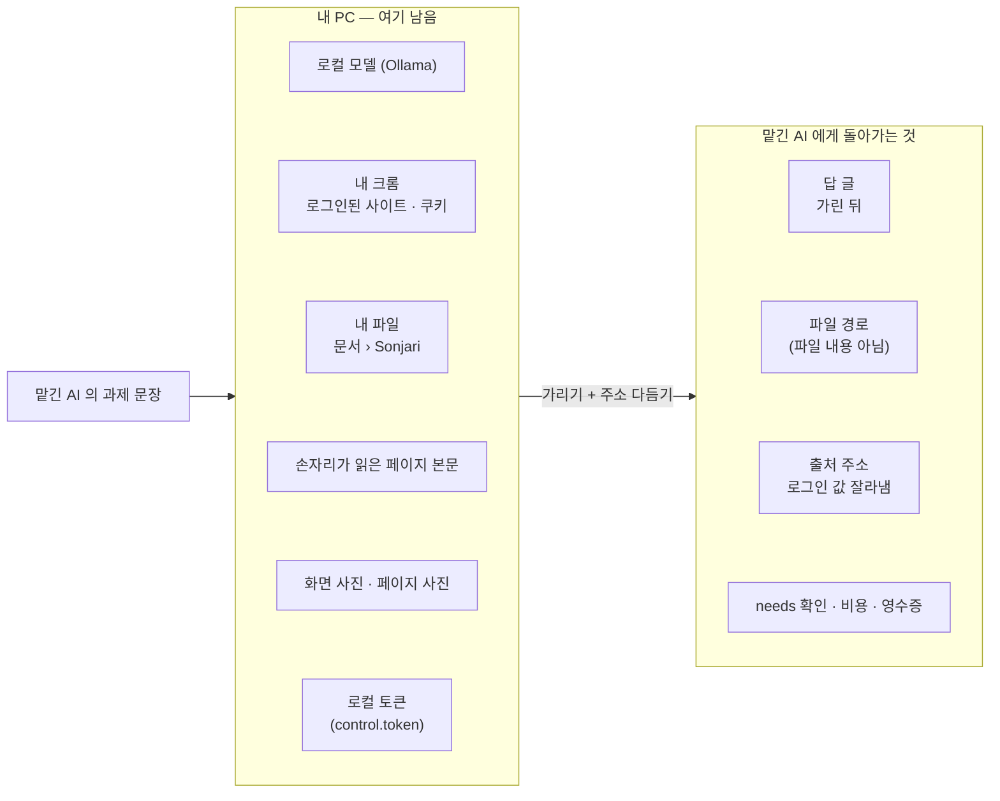

# 내 PC 밖으로 나가는 것 · 안 나가는 것

[English](privacy.md) · **한국어**

손자리의 모델은 내 PC 에서 돕니다. 그런데 다른 AI(클로드 코드 · 코덱스 · 커서 …)가 MCP 로 손자리에게 일을 맡기면, 그 AI 는
보통 클라우드에서 돌기 때문에 **손자리가 돌려주는 것은 그 AI 회사로 갑니다.** 이 문서는 그게 정확히 무엇인지 보여 줍니다.

## 한눈에



| | 내 PC 에 남는 것 | 맡긴 AI 에게 가는 것 |
|---|---|---|
| 모델 | 로컬(Ollama)에서 돔 | — |
| 손자리가 읽은 페이지 | 본문 전체가 여기 남음 | 답에 들어간 부분만 |
| 로그인 · 쿠키 | 내 크롬에 남음 | 절대 안 감 |
| 손자리가 만든 파일 | 파일은 `문서\Sonjari` 에 남음 | **경로**만 |
| 페이지 사진 | 그림은 여기 남음 | 경로 · 주소 · 제목 · 시각. 가린 값이 있던 페이지의 사진은 통째로 뺌 |
| 출처 주소 | — | 감 · 로그인 값은 잘라냄(아래) |
| 로컬 토큰 | 파일에 남음 | MCP 설정에는 **파일 경로**만 |

## 답에서 가리는 것

손자리는 무엇이 민감한지 모델에게 묻지 않고 **모양**으로 가립니다. 가린 값은 `[가림: 종류]` 로 바뀌고, 결과에 종류별로 몇 개를
가렸는지 적힙니다.

| 종류 | 규칙 |
|---|---|
| 주민등록번호 | 늘 가림 |
| 카드 번호(룬 검사 통과한 것) | 늘 가림 |
| 비밀 키(`sk-…`, `ghp_…`, `AKIA…`, `AIza…`, `xox…`) | 늘 가림 |
| 전화번호 | 맡긴 AI 가 `needs` 에 밝힌 경우(예: `"연락처"`, `"전화"`)**만** 내보냄 |
| 메일 주소 | `needs` 에 밝힌 경우(예: `"연락처"`, `"메일"`)**만** 내보냄 |

`needs` 에 항목을 적는 것이 「이게 없으면 일을 못 끝낸다」고 맡긴 AI 가 밝히는 방법입니다. 그 밖의 길로는 열리지 않습니다.

가리는 것은 **나가는 답**뿐입니다. 내 PC 의 파일은 고치지 않습니다 — 파일에 전화번호가 있으면 파일에는 그대로 있고, 밖으로는
경로만 나갑니다.

## 출처 주소

로그인 · 계정 화면 주소에는 한 번 쓰는 값(`code_challenge`, `nonce`, `state`, 토큰)이 붙습니다. 손자리는 「그 화면을 봤다」는 사실은
남기고 주소는 `scheme://host/path` 까지로 줄입니다.

```text
https://accounts.google.com/v3/signin/accountchooser?client_id=…&code_challenge=…&nonce=…
→ https://accounts.google.com/v3/signin/accountchooser
```

- 로그인 호스트 · 경로(`login.`, `auth.`, `/signin`, `/oauth2.0`, `/authorize` …): `?` 와 `#` 뒤를 통째로 버림
- 늘 비밀인 이름(`access_token`, `id_token`, `password`, `client_secret` …)이 `?` · `#` 뒤에 있으면: 같은 처리
- `code` · `state` 같은 흔한 이름은 OAuth 표식(`client_id`, `redirect_uri` …)이 같이 있을 때만 — 증권 화면의 `?code=005930` 은 그대로
- `user:pass@` 는 버림
- 아직 못 가리는 것: 경로 자체에 토큰을 박는 사이트(`/reset/<토큰>`)

## 맡긴 AI 가 못 하는 것

- 되돌릴 수 없는 동작(보내기 · 게시 · 결제 · 삭제)은 기본으로 MCP 에 안 내보냅니다(`JARVIS_MCP_MAX_RISK=L1`).
- 로그인 · 보안 문자 · 결제 화면은 사람에게 넘깁니다 — 손자리는 비밀번호를 넣거나 보안 문자를 풀지 않습니다.
- `문서\Sonjari` 밖에 저장하려면 손자리 창에서 사람이 승인해야 합니다.
- 코드 일은 따로 딴 가지에서 하고, 내 폴더는 바꾸지 않습니다.

## 그 밖의 통신

| 무엇 | 언제 |
|---|---|
| 모델 받기(Ollama · 허깅페이스) | 마법사나 설정에서 모델을 고를 때 |
| 마이크로소프트 스토어 업데이트 | 윈도우가 함 |
| 문제 보내기 | 「문제 보내기」를 누르고 보여 준 내용에 동의했을 때만 |
| 물어본 사이트 | 내가 하듯 내 크롬으로 들어감 |
| 디스코드 | 「디스코드로 일 시키기」를 설정했을 때만 — 내 메시지와 손자리 답이 디스코드를 거침 |
| 클로드 코드(넘기기) | 「막히면 내 클로드에게 넘기기」를 켰을 때만(기본 꺼짐) — 막힌 코드 일이 이 PC 의 클로드 코드로 가고 내 클로드 사용 한도를 씀 |
| 구글 · 네이버 | 설정에서 그 계정을 이었을 때만 |

이 일을 하는 코드는 공개돼 있습니다: `src/alture_jarvis/outbound.py`(가리기 · `needs`), `url_privacy.py`(주소),
`mcp_server.py`(어떤 도구를 내보내는지).
