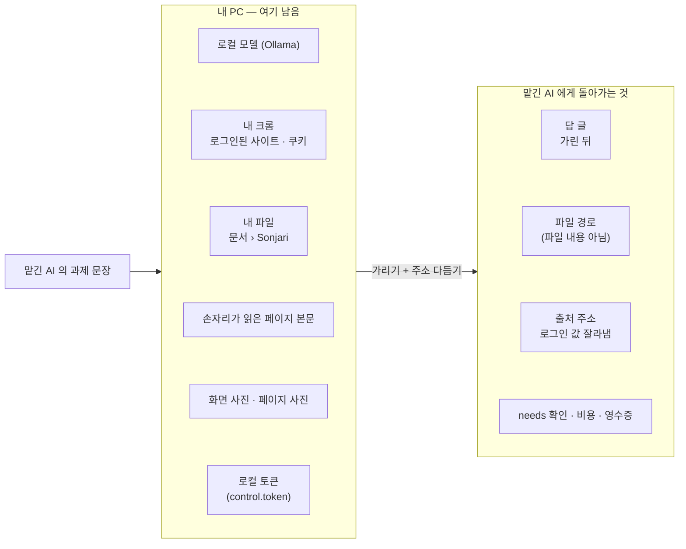

# 내 PC 밖으로 나가는 것과 안 나가는 것

[English](privacy.md) · **한국어**

손자리의 모델은 내 PC 에서 돕니다. 그런데 클로드 코드나 코덱스, 커서 같은 다른 AI 가 MCP 로 손자리에게 일을 맡기면 얘기가 조금
달라집니다. 그 AI 들은 대부분 클라우드에서 돌기 때문에, 손자리가 돌려주는 내용은 그 AI 회사로 넘어갑니다. 이 문서는 그때 정확히
무엇이 나가고 무엇이 남는지 정리한 것입니다.

## 한눈에 보기



| | 내 PC 에 남는 것 | 맡긴 AI 에게 가는 것 |
|---|---|---|
| 모델 | 내 PC 의 Ollama 에서 돕니다 | 없음 |
| 손자리가 읽은 페이지 | 본문은 전부 여기 남습니다 | 답에 쓴 부분만 갑니다 |
| 로그인, 쿠키 | 내 크롬에 그대로 있습니다 | 가지 않습니다 |
| 손자리가 만든 파일 | 파일은 `문서\Sonjari` 에 있습니다 | 파일 경로만 갑니다 |
| 페이지 사진 | 그림 파일은 여기 남습니다 | 경로, 주소, 제목, 시각만 갑니다. 가려야 할 값이 있던 페이지의 사진은 아예 빼고 보냅니다 |
| 출처 주소 | | 갑니다. 다만 로그인 화면의 값은 잘라 냅니다(아래 참고) |
| 로컬 토큰 | 파일로만 있습니다 | MCP 설정에는 그 파일의 경로만 들어갑니다 |

## 답에서 가리는 것

무엇이 민감한지는 모델에게 묻지 않습니다. 정해진 모양에 맞으면 가립니다. 가린 자리는 `[가림: 종류]` 로 바뀌고, 결과에는 종류마다
몇 개를 가렸는지 같이 적힙니다.

| 종류 | 어떻게 하나 |
|---|---|
| 주민등록번호 | 항상 가립니다 |
| 카드 번호 (룬 검사를 통과한 것) | 항상 가립니다 |
| 비밀 키 (`sk-…`, `ghp_…`, `AKIA…`, `AIza…`, `xox…`) | 항상 가립니다 |
| 전화번호 | 기본은 가립니다. 맡긴 AI 가 `needs` 에 `"연락처"` 나 `"전화"` 처럼 적었을 때만 그대로 보냅니다 |
| 메일 주소 | 기본은 가립니다. `needs` 에 `"연락처"` 나 `"메일"` 처럼 적었을 때만 그대로 보냅니다 |

`needs` 에 항목을 적는다는 건 맡긴 AI 가 「이게 없으면 일을 끝낼 수 없다」고 밝히는 것입니다. 이 방법 말고 가린 값을 여는 길은 없습니다.

가리는 건 밖으로 나가는 답뿐입니다. 내 PC 에 있는 파일은 손대지 않습니다. 파일 안에 전화번호가 있으면 파일에는 그대로 남아 있고,
밖으로는 그 파일의 경로만 나갑니다.

## 출처 주소는 이렇게 다듬습니다

로그인이나 계정 화면 주소에는 그때 한 번만 쓰는 값(`code_challenge`, `nonce`, `state`, 토큰 같은 것)이 붙어 있습니다. 손자리는
「그 화면을 봤다」는 사실만 남기고, 주소는 `scheme://host/path` 까지만 보냅니다.

```text
https://accounts.google.com/v3/signin/accountchooser?client_id=…&code_challenge=…&nonce=…
→ https://accounts.google.com/v3/signin/accountchooser
```

- 로그인용 주소(`login.`, `auth.`, `/signin`, `/oauth2.0`, `/authorize` 등)는 `?` 와 `#` 뒤를 통째로 버립니다.
- `access_token`, `id_token`, `password`, `client_secret` 처럼 항상 비밀인 이름이 붙어 있어도 똑같이 버립니다.
- `code` 나 `state` 같은 흔한 이름은 `client_id`, `redirect_uri` 같은 로그인 표시가 같이 있을 때만 버립니다. 그래서 주식 화면의
  `?code=005930` 같은 주소는 그대로 남습니다.
- 주소 안에 들어 있는 `user:pass@` 도 버립니다.
- 주소 경로 자체에 토큰을 박아 넣는 사이트(`/reset/<토큰>` 같은 것)는 아직 가리지 못합니다.

## 맡긴 AI 가 할 수 없는 것

- 되돌릴 수 없는 일(메일 보내기, 글 올리기, 결제, 삭제)은 기본 설정(`JARVIS_MCP_MAX_RISK=L1`)에서는 아예 MCP 로 내보내지 않습니다.
- 로그인, 보안 문자, 결제 화면이 나오면 사람에게 넘깁니다. 손자리는 비밀번호를 넣거나 보안 문자를 풀지 않습니다.
- `문서\Sonjari` 밖에 파일을 저장하려면 손자리 창에서 사람이 승인해야 합니다.
- 코드 일은 따로 꺼낸 가지에서만 하고, 내 작업 폴더는 건드리지 않습니다.

## 그 밖에 밖으로 나가는 통신

| 무엇 | 언제 |
|---|---|
| 모델 받기 (Ollama, 허깅페이스) | 마법사나 설정에서 모델을 고를 때 |
| 마이크로소프트 스토어 업데이트 | 윈도우가 알아서 합니다 |
| 문제 보내기 | 「문제 보내기」를 누르고, 보여 드린 내용에 동의했을 때만 |
| 물어본 사이트 | 내가 직접 들어가는 것처럼 내 크롬으로 들어갑니다 |
| 디스코드 | 「디스코드로 일 시키기」를 설정했을 때만. 내 메시지와 손자리 답이 디스코드를 거칩니다 |
| 클로드 코드(넘기기) | 「막히면 내 클로드에게 넘기기」를 켰을 때만(처음엔 꺼져 있습니다). 막힌 코드 일이 이 PC 의 클로드 코드로 가고, 내 클로드 사용 한도를 씁니다 |
| 구글, 네이버 | 설정에서 그 계정을 연결했을 때만 |

이 일을 하는 코드는 모두 공개돼 있습니다. 가리기와 `needs` 는 `src/alture_jarvis/outbound.py`, 주소 다듬기는 `url_privacy.py`,
어떤 도구를 밖으로 내보내는지는 `mcp_server.py` 에 있습니다.
