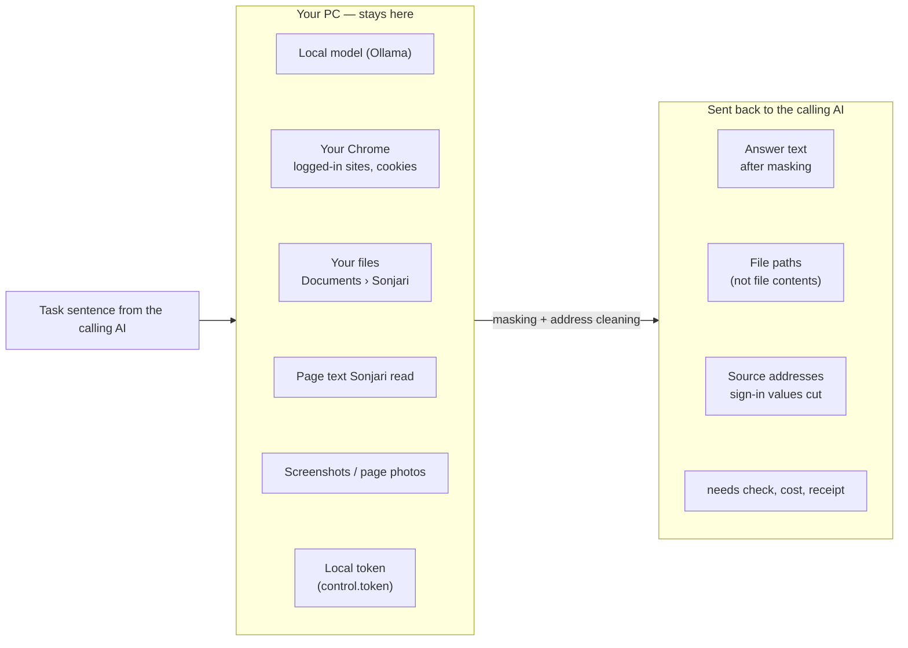

# What leaves your PC — and what does not

**English** · [한국어](privacy.ko.md)

Sonjari's model runs on your PC. When another AI (Claude Code, Codex, Cursor …) hands Sonjari a task over MCP, that other
AI usually runs in the cloud — so **whatever Sonjari sends back goes to that AI's provider**. This page shows exactly what
that is.

## At a glance



| | Stays on your PC | Goes back to the calling AI |
|---|---|---|
| The model | runs locally (Ollama) | — |
| Pages Sonjari reads | full text stays here | only what ends up in the answer |
| Your logins and cookies | stay in your Chrome | never |
| Files Sonjari makes | the files stay in `Documents\Sonjari` | their **paths** only |
| Page photos | the images stay here | path, address, title, time — and pages that held masked values are left out entirely |
| Source addresses | — | yes, with sign-in values cut (below) |
| The local token | stays in a file | the MCP config only holds the **file path** |

## Masking in the answer

Sonjari masks by **pattern**, not by asking a model what looks sensitive. A masked value becomes `[가림: kind]` and the
result says how many of each kind were masked.

| Kind | Rule |
|---|---|
| Resident registration numbers | always masked |
| Card numbers (Luhn-checked) | always masked |
| Secret keys (`sk-…`, `ghp_…`, `AKIA…`, `AIza…`, `xox…`) | always masked |
| Phone numbers | masked **unless** the calling AI named them in `needs` (e.g. `"contact"`, `"phone"`) |
| E-mail addresses | masked **unless** named in `needs` (e.g. `"contact"`, `"email"`) |

Naming an item in `needs` is how the calling AI says "the task cannot be done without this". Nothing else opens a kind up.

Only the **outgoing answer** is masked. Files on your PC are not changed — if a file holds a phone number, it is still in
the file, and only its path goes out.

## Source addresses

Sign-in and account pages carry one-time values (`code_challenge`, `nonce`, `state`, tokens). Sonjari keeps the fact that
it saw the page but cuts the address to `scheme://host/path`:

```text
https://accounts.google.com/v3/signin/accountchooser?client_id=…&code_challenge=…&nonce=…
→ https://accounts.google.com/v3/signin/accountchooser
```

- Sign-in hosts and paths (`login.`, `auth.`, `/signin`, `/oauth2.0`, `/authorize` …): everything after `?` and `#` is cut.
- Always-secret names after `?` or `#` (`access_token`, `id_token`, `password`, `client_secret` …): same.
- Common names like `code` or `state` are cut only next to OAuth markers (`client_id`, `redirect_uri` …) — a stock page's
  `?code=005930` stays.
- `user:pass@` is dropped.
- Not covered yet: sites that put a token in the path itself (`/reset/<token>`).

## What the calling AI cannot do

- Irreversible actions (send, publish, pay, delete) are not exported over MCP by default (`JARVIS_MCP_MAX_RISK=L1`).
- Sign-in pages, CAPTCHAs and payment screens are handed to you — Sonjari does not fill passwords or solve CAPTCHAs.
- Saving outside `Documents\Sonjari` needs your approval in the Sonjari window.
- Code jobs work on a separate branch; your folder is not changed.

## Other traffic

| What | When |
|---|---|
| Model downloads (Ollama, Hugging Face) | when you pick a model in the wizard or settings |
| Microsoft Store updates | handled by Windows |
| Problem reports | only when you press *Send a problem* and agree to the preview shown |
| The sites you ask about | Sonjari visits them in your Chrome, like you would |
| Discord | only if you set up *Work from Discord*: your messages and Sonjari's answers go through Discord |
| Claude Code (hand-off) | only if you turn on *Hand off to my Claude when stuck* (off by default): a stuck coding job goes to Claude Code on this PC and uses your Claude plan |
| Google / Naver | only if you connect those accounts in Settings |

The code that does this is public: `src/alture_jarvis/outbound.py` (masking, `needs`), `url_privacy.py` (addresses),
`mcp_server.py` (which tools are exported).
