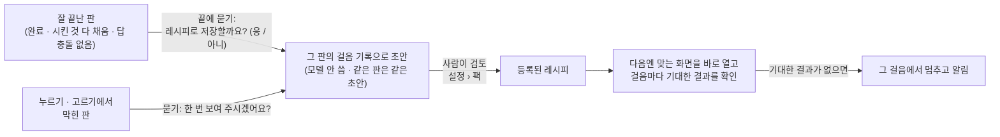

# 레시피 — 한 번 잘 해낸 일은 다음엔 그대로 따라 합니다

[English](recipes.md) · **한국어**

레시피는 사이트에서 하는 절차를 걸음으로 적고, 걸음마다 화면에 무엇이 있어야 하는지 붙인 것입니다. 레시피가 있으면 손자리는
길을 다시 찾지 않고 그 절차를 따라가며, 걸음마다 확인합니다.

## 레시피가 생기는 길

- **잘 해낸 판에서.** 판이 깔끔하게 끝나면 손자리가 레시피로 남길지 묻고, 무엇을 하고 무엇을 확인할지 읽어 줍니다. 손자리
  대화창에서 「응」이라고 하면 됩니다. 끝까지 했고, 시킨 것을 다 채웠고, 답이 서로 부딪히지 않은 판만 묻습니다.
- **사람이 한 번 보여 줘서.** 어떤 사이트에서 누르기나 고르기로 막히면 한 번 보여 달라고 묻습니다. 같은 사이트는 두 번까지만 묻습니다.
- **손으로 써서.** 레시피는 [`recipes/`](../../recipes/) 의 JSON 파일입니다. 파이썬을 몰라도 됩니다. 형식은 그 폴더에 있습니다.

## 초안은 이렇게 만듭니다

판 기록에서 그대로 옮깁니다. 연 주소, 누르고 적은 것, 그리고 그 걸음 바로 뒤 화면에서 실제로 바뀐 것입니다. 모델이 쓰지 않으니
같은 판에서는 늘 같은 초안이 나옵니다.

- 판마다 달라지는 번호는 버리고, 다시 찾을 수 있는 셀렉터로 적습니다.
- 사람이 넣은 검색어는 빈칸(`{query}`)이 되어 다음 검색에도 씁니다.
- 화면을 바꾸는 걸음에는 실제로 바뀐 것에서 뽑은 「기대한 결과」가 있어야 합니다. 그런 증거가 없으면 초안을 쓰지 않습니다.
  확인 없는 걸음은 다른 절차가 되기 때문입니다.
- 초안은 결과 목록 화면까지입니다. 그 뒤에 무엇을 여는지는 그날의 자료에 달렸습니다.

초안은 **설정 › 팩**에 모입니다. 성공한 판에서 나온 초안만 등록할 수 있습니다.

## 아는 것과 모르는 것

- 레시피는 이미 있는 브라우저를 움직일 뿐입니다. 새 능력을 더하거나 승인을 건너뛸 수 없습니다.
- 저장한 레시피가 사이트가 바뀌는 몇 주 뒤에도 얼마나 그대로 되는지는 아직 재지 않았습니다.
