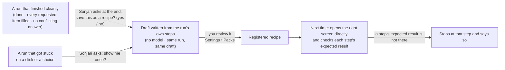

# Recipes — a job it did well once, it follows next time

**English** · [한국어](recipes.ko.md)

A recipe is a site procedure written as steps, with what should be on the screen after each step. Once a recipe exists,
Sonjari follows it instead of finding its way again, and checks every step as it goes.

## Where recipes come from

- **From a run that went well.** At the end of a clean run, Sonjari asks if it should keep the job as a recipe, and reads
  out what it will do and what it will check. Say *yes* in the Sonjari chat. Only runs that finished, filled every
  requested item and had no conflicting answer are offered.
- **From you, once.** When a run gets stuck on a click or a choice on a site, Sonjari asks you to show it once. The same
  site is asked about at most twice.
- **Written by hand.** A recipe is a JSON file in [`recipes/`](../../recipes/) — no Python needed. See the format there.

## How a draft is made

The draft comes straight from the run's record — the addresses it opened, what it clicked and typed, and what changed on
the screen right after each of those steps. No model writes it, so the same run always gives the same draft.

- Run-specific numbers are dropped and replaced with selectors that can be found again.
- What you typed becomes a slot (`{query}`), so the recipe works for the next search too.
- Every step that changes the page needs an expected result taken from what really changed. If there is no such evidence,
  no draft is written — a step without a check would be a different procedure.
- The draft stops at the result list. What you open after that depends on the data of that day.

Drafts are listed in **Settings › Packs**. Only drafts from a successful run can be registered.

## What we know and what we don't

- Recipes drive the existing browser; they cannot add new abilities or skip an approval.
- We have not yet measured how often a saved recipe still runs cleanly weeks later, as sites change.
