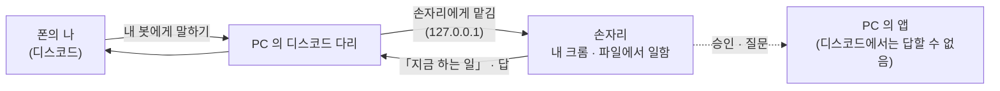

# 폰에서 시키기 — 디스코드

[English](remote.md) · **한국어**

폰의 디스코드로 손자리에게 말을 보내면 집 PC 가 일을 합니다. 진행 상황과 답은 같은 대화로 돌아옵니다.

## 잇는 법

**설정 › 디스코드로 일 시키기.** 클릭 몇 번으로 따라가면 됩니다.

1. 내 디스코드 봇을 만들고 **Bot** 페이지에서 토큰을 복사합니다(「Reset Token」 → 「Copy」).
2. 손자리가 클립보드에서 읽어 **윈도우 자격 증명 관리자**에 둡니다. 설정 파일에 적지 않습니다.
3. 봇의 **Message Content Intent** 를 켜고, 내 서버에 봇을 초대합니다.

봇은 내 것입니다. 우리 서버를 거치는 것은 없습니다.

## 누가 일을 시킬 수 있나

- 처음엔 나만.
- 다른 사람이 봇에게 말을 걸면 일을 **시작하지 않습니다.** PC 의 앱에 카드가 뜨고, 내가 「허용」을 눌러야 그 사람도 일을 시킬 수
  있습니다. 「무시」한 사람에게는 답하지 않습니다.

## 디스코드에서는 하지 않는 것

- **승인은 PC 에서만.** 메일 보내기 · 올리기 · 결제 · 지우기는 앱의 승인 카드를 기다립니다. 디스코드에는 기다린다는 말만 갑니다.
- 디스코드로 가는 답은 PC 밖으로 나가므로 먼저 걸러 냅니다. 주민번호 · 카드 번호 · 비밀 키는 가립니다.
- PC 앞에 앉은 사람의 일이 먼저 나갑니다.
