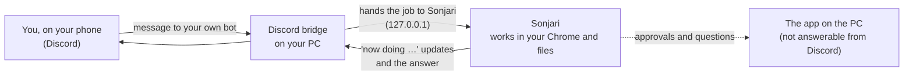

# Work from your phone — Discord

**English** · [한국어](remote.ko.md)

Send Sonjari a message from Discord on your phone, and the PC at home does the job. The progress and the answer come back
to the same chat.

## Set it up

**Settings › Work from Discord.** It walks you through it in a few clicks:

1. Create your own Discord bot and copy its token from the **Bot** page ("Reset Token" → "Copy").
2. Sonjari reads it from the clipboard and keeps it in **Windows Credential Manager** — not in a settings file.
3. Turn on **Message Content Intent** for the bot, then invite it to a server you own.

The bot is yours. Nothing goes through a server of ours.

## Who can give it work

- Only you, at first.
- If someone else messages the bot, it does **not** start any work. A card appears in the app on your PC; only when you
  press *Allow* can that person give tasks too. People you ignore get no reply.

## What it does not do from Discord

- **Approvals stay on the PC.** Sending mail, publishing, paying and deleting wait for the approval card in the app. From
  Discord you are only told that it is waiting.
- Answers going out to Discord leave your PC, so they are cleaned first — personal ID numbers, card numbers and secret
  keys are masked.
- A job from the person sitting at the PC goes first.
