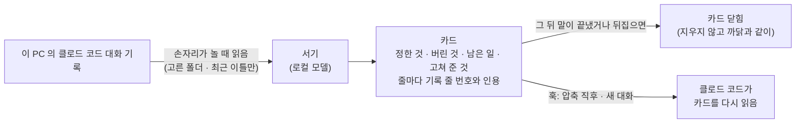

# 서기 — 압축돼도 클로드 코드가 정한 것을 잊지 않게

[English](scribe.md) · **한국어**

클로드 코드는 대화가 길어지면 앞부분을 요약하고, 그때 오래된 결정이 빠집니다. 서기는 손자리가 노는 시간에 그걸 적어 두었다가,
대화가 압축된 직후나 새 대화를 열 때 클로드에게 다시 넣어 줍니다.

## 켜는 법

**설정 › 서기.** 읽을 프로젝트 폴더를 하나 이상 고르세요. 고르기 전에는 아무것도 읽지 않습니다. **기본은 꺼져 있습니다.**

켜면 클로드 코드 설정(`~/.claude/settings.json`)에 훅 셋을 넣고, 끄면 우리 것만 뺍니다. 훅은 `127.0.0.1` 로 손자리를 부르고,
손자리가 꺼져 있으면 조용히 끝나서 클로드 코드를 막지 않습니다.

## 카드는 이렇게 생겼습니다

- **종류:** 정한 것, 버린 것과 그 까닭, 남은 일, 사람이 거듭 고쳐 준 것.
- **줄마다 어디서 나왔는지가 붙습니다.** 대화 기록의 줄 번호와 짧은 인용입니다. 인용이 그 말에 실제로 없으면 그 줄은 버립니다.
  그래서 서기가 결정을 지어낼 수 없습니다.
- **카드는 지우지 않고 닫습니다.** 뒤에 나온 말이 그 카드를 끝냈거나 뒤집었거나 틀렸다고 보이면, 그 인용과 함께 닫습니다.
  확실하지 않으면 「줄 N 에서 같은 이야기가 또 나옴 — 확인」 표시만 남깁니다.
- **비밀값은 먼저 걷어 냅니다**(키 · 토큰). 그다음에야 로컬 모델이 글을 봅니다.

쌓인 카드는 손자리와 이어진 클로드에게 「서기 카드 보여 줘」라고 하면 꺼내 봅니다.

## 아는 것과 모르는 것

- 실제로 쓰면서, 압축 뒤에 카드가 다시 들어오고 사람이 정한 작업 규칙이 살아남는 것을 봤습니다.
- 처음 점검에서 「남은 일」이 끝난 뒤에도 열려 있는 문제가 있었습니다. 그래서 닫기를 따로 만들었고 뒤에서 다시 읽으며 닫습니다.
  그래도 낡은 카드가 남을 수 있습니다. 카드는 출발점이지 사실이 아닙니다. 중요하면 줄 번호를 열어 보세요.
- 서기를 켰을 때와 껐을 때 압축 뒤에 결정이 얼마나 살아남는지는 아직 재지 않았습니다.
