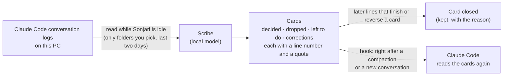

# Scribe — Claude Code keeps what you decided, even after compaction

**English** · [한국어](scribe.ko.md)

When a Claude Code conversation gets long, it summarizes the start, and older decisions drop out. The scribe writes them
down while Sonjari is idle and hands them back to Claude right after a compaction or when you open a new conversation.

## Turn it on

**Settings › Scribe.** Pick at least one project folder — the scribe reads nothing until you do. It is **off by default**.

Turning it on adds three hooks to Claude Code's `~/.claude/settings.json`; turning it off removes only ours. The hooks
call Sonjari over `127.0.0.1` and end quietly if Sonjari is not running, so Claude Code is never blocked.

## What a card is

- **Kinds:** what was decided, what was dropped and why, what is left to do, and what the person corrected more than once.
- **Every line carries where it came from** — the line number in the conversation log and a short quote. A line whose quote
  is not actually in that message is thrown away, so the scribe cannot make up a decision.
- **Cards are closed, not deleted.** When a later part of the conversation finishes, reverses or disproves a card, the card
  is closed with that quote. If the scribe is not sure, it only marks "the same topic comes up again at line N — check".
- **Secrets are removed first** (keys, tokens) before the local model sees the text.

To see the cards, ask a Claude that's connected to Sonjari to "show the scribe cards".

## What we know and what we don't

- In real use, cards came back after a compaction and the person's working rules survived it.
- An early check found that "left to do" cards stayed open after the work was done; that is why closing was added and is
  re-checked in the background. Some cards can still be stale — they are a starting point, not the truth. Open the line
  number when it matters.
- We have not measured how many decisions survive a compaction with versus without the scribe.
