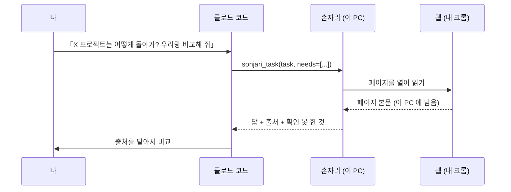
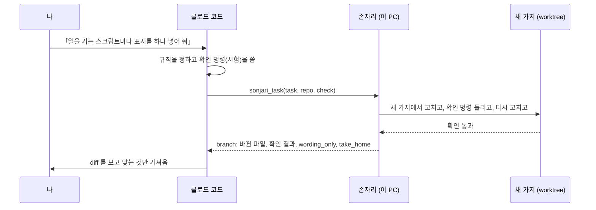

# 만든 사람이 실제로 쓰는 법 (클로드 코드 + 손자리)

[English](workflows.md) · **한국어**

저희는 손자리를 만들면서 매일 이렇게 씁니다. 생각하고 결정하는 건 클로드 코드에 맡기고, 페이지를 읽거나 손이 많이 가는 일은
손자리가 이 PC 에서 합니다. 아래 숫자는 보여 주려고 따로 돌린 게 아니라 2026년 10월 20일에 실제로 일하면서 남은 기록입니다.

## 어떤 일을 넘기나

| 손자리에게 넘기는 일 | 클로드 코드가 그냥 하는 일 |
|---|---|
| 페이지를 여러 장 읽고 결과만 짧게 받으면 되는 일 | 설계를 정하는 일, 처음 보는 API |
| 내가 로그인해 둔 크롬이 있어야 하는 일 | 30초 안에 답이 와야 하는 일 |
| 여러 파일에 같은 규칙을 적용하는 일 (확인 명령이 있을 때) | 다 됐는지를 명령으로 확인할 수 없는 일 |
| 엑셀, 워드, 한글, PDF 파일 만들기 | |

손자리는 로컬 모델이라 클로드보다 느립니다. 대신 페이지와 파일을 이 PC 에서 읽고 결과만 돌려주니까, 클로드 대화 창이 덜 차고
사용 한도도 덜 씁니다. 저희가 손자리를 쓰는 이유는 속도가 아니라 이쪽입니다.

## 1. 조사를 맡길 때



실제로 이렇게 썼습니다. 다른 오픈소스 데스크톱 에이전트와 손자리를 비교하고 싶어서 클로드 코드에 물었고, 클로드는 문서 읽는 일을
손자리에게 한 번에 넘겼습니다.

```text
sonjari_task(
  task="github.com/<org>/<repo> 의 README 와 문서를 읽고 정리해 줘: 무슨 앱인지, 브라우저를 어떻게 조작하는지
        (라이브러리? 화면 좌표? DOM?), 로컬 모델로 도는지, 지원 운영체제, 라이선스, 별 개수와 마지막 커밋 날짜.
        확인한 것과 못 찾은 것을 나눠서.",
  needs=["무슨 앱", "브라우저 조작 방식", "로컬 모델", "라이선스", "별 개수", "마지막 커밋"])
```

| | |
|---|---|
| 걸린 시간 | 189초 |
| 이 PC 에서 읽은 페이지 | 6쪽 |
| 클로드 대화 창에 안 들어간 본문 | 최소 8,136토큰 (적게 잡은 값이고, 한국어 본문이면 실제로는 두 배쯤 됩니다) |
| `needs` 확인 | 6개 중 5개 채움. 1개는 답에 있었는데 검사가 그 칸을 못 찾았습니다 |

클로드는 손자리가 준 답과 출처(`sources`)만 보고 비교 글을 썼습니다. 클로드가 직접 연 페이지는 한 장도 없습니다.

써 보니 이런 게 도움이 됐습니다.

- 「확인한 것과 못 찾은 것을 나눠 달라」고 적어 주세요. 손자리는 모르면 지어내지 않고 못 찾았다고 말하게 만들어져 있어서, 이렇게
  부탁하면 답이 깔끔하게 나뉩니다.
- 꼭 받아야 하는 항목은 `needs` 에 이름으로 적어 주세요. 항목마다 채웠는지 따로 알려 줍니다.
- 로그인이 필요한 사이트는 내 크롬에서 미리 한 번 열어 두세요. 손자리는 그 로그인을 그대로 쓰고, 비밀번호는 직접 넣지 않습니다.

## 2. 코딩을 맡길 때

설계와 확인 방법은 클로드가 정하고, 실제로 고치고 돌려 보는 건 손자리가 합니다.



실제로 이렇게 썼습니다. 벤치 스크립트 24개가 손자리 백엔드에 일을 거는데, 요청마다 `"measurement": true` 를 넣어야 했습니다.
규칙과 시험은 클로드가 쓰고, 파일 고치는 일은 손자리에게 넘겼습니다.

```text
sonjari_task(
  task="bench/ 아래에서 /v1/chat 이나 /v1/jobs 로 일을 거는 스크립트마다 요청 본문에 \"measurement\": True 를 넣고,
        그걸 확인하는 tests/test_bench_scripts_mark_measurement.py 를 써 줘.",
  repo="C:/work/sonjari",
  check="python -m pytest -q tests/test_bench_scripts_mark_measurement.py")
```

| | |
|---|---|
| 걸린 시간 | 28.6분 (91걸음). 느렸고, 대부분은 로컬 모델이 생각하는 데 쓴 시간입니다 |
| 확인 명령 | 통과 |
| 바뀐 파일 | 파이썬 41개 (고친 것 40, 새 시험 1) |
| `branch.wording_only` | 16개. 코드는 그대로이고 주석이나 설명 글만 바뀐 파일입니다 |

여기서 봐야 할 건 마지막 줄입니다. 저희가 쓴 시험이 허술했습니다. 파일 안에 measurement 라는 낱말이 있는지만 봤거든요.
그랬더니 손자리가 일을 걸지도 않는 조회 스크립트 16개에 코드 대신 주석을 넣어서 시험을 통과시켰습니다. `wording_only` 가 그 16개를
정확히 짚었고, 진짜 코드를 고친 24개는 하나도 잘못 짚지 않았습니다. 그래서 24개만 가져오고 16개는 버렸고, 시험도 「요청 본문에
키가 있어야 한다」로 고쳤습니다.

써 보니 이런 게 도움이 됐습니다.

- 넘기기 전에 확인 명령부터 쓰세요. 시험이 허술하면 고친 결과도 허술하게 나옵니다. 그런 일이 생기면 `wording_only` 가 알려 줍니다.
- 작게 넘기세요. 규칙 하나를 여러 파일에 적용하는 일이나, 파일 한두 개짜리 일이 잘 됩니다. 큰 설계는 클로드에 남겨 두세요.
- 가져오기 전에 `branch.take_home.review` 로 바뀐 걸 보고, `branch.take_home.take`(`cherry-pick -n`)로 가져오세요.
  커밋은 손자리가 대신 하지 않습니다.
- 내 작업 폴더는 건드리지 않습니다. 필요 없으면 `branch.take_home.discard` 로 가지를 지우면 끝입니다.

## 3. 손자리가 막혔을 때

| 이런 게 보이면 | 이렇게 하세요 |
|---|---|
| 로그인이나 보안 문자 화면에서 `needs_decision` | 크롬에서 그 단계만 직접 해 주세요. 끝나면 손자리가 알아서 이어 갑니다 |
| 「같은 자리에서 막혔다」는 `needs_decision` | `message` 에 적힌 내용(한 것, 막힌 곳, 해 주실 일)을 그대로 보면 됩니다 |
| `resume` 이 붙은 `failed` | `resume.next` 로 새 과제를 걸어 주세요. `resume.evidence` 에 있는 페이지는 이미 읽은 거라 다시 열 필요가 없습니다 |
| 끝까지 통과를 못 하는 코드 일 | 설정 › 연결의 「막히면 내 클로드에게 넘기기」를 켜거나(처음엔 꺼져 있습니다), 클로드 코드로 가져와서 마무리하세요 |

같이 보면 좋은 문서: [MCP 사용법](mcp.ko.md) · [내 PC 밖으로 나가는 것](privacy.ko.md) · [모델을 고르는 방식](models.ko.md)
