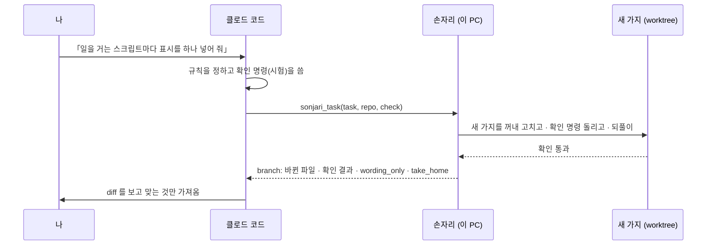

# 만든 사람이 실제로 쓰는 법 — 클로드 코드 + 손자리

[English](workflows.md) · **한국어**

손자리를 만드는 사람들이 매일 실제로 쓰는 방식입니다. 생각은 클로드 코드가 하고, 읽기와 손이 많이 가는 일은 손자리가 이 PC 에서
합니다. 아래 숫자는 시연이 아니라 2026-10-20 에 실제로 돌린 판입니다.

**고르는 기준**

| 손자리에게 | 클로드 코드에 남김 |
|---|---|
| 페이지를 많이 읽고 짧은 결과만 받으면 되는 일 | 설계 결정, 처음 보는 API |
| 로그인된 내 크롬이 필요한 일 | 30초 안에 답이 필요한 일 |
| 확인 명령이 있는, 여러 파일에 걸친 좁고 기계적인 고침 | 「끝났다」를 명령으로 못 적는 고침 |
| 엑셀 · 워드 · 한글 · PDF 파일 만들기 | — |

손자리의 로컬 모델은 클로드보다 느립니다. 대신 얻는 것은 **대화 창과 사용 한도**입니다. 페이지와 파일은 이 PC 에서 읽고, 결과만
클로드 대화로 돌아옵니다.

---

## 1. 조사 — 「이거 읽고 알려 줘」


**실제 사례.** 다른 오픈소스 데스크톱 에이전트와 손자리를 비교해 달라고 클로드 코드에 부탁했습니다. 클로드는 읽는 일을 한 번에
손자리에게 넘겼습니다.

```text
sonjari_task(
  task="github.com/<org>/<repo> 의 README 와 문서를 읽고 정리해 줘: 무슨 앱인지, 브라우저를 어떻게 조작하는지
        (라이브러리? 화면 좌표? DOM?), 로컬 모델로 도는지, 지원 운영체제, 라이선스, 별 개수와 마지막 커밋 날짜.
        확인한 것과 못 찾은 것을 나눠서.",
  needs=["무슨 앱", "브라우저 조작 방식", "로컬 모델", "라이선스", "별 개수", "마지막 커밋"])
```

| | |
|---|---|
| 걸린 시간 | 189초 |
| 이 PC 에서 읽은 페이지 | 6쪽 |
| 클로드 대화 창에 안 실린 본문 | 최소 8,136토큰(하한 — 한국어 본문이면 실제는 두 배쯤) |
| `needs` | 6개 중 5개 채움, 1개 「자리를 못 찾음」 — 답에는 있었는데 검사가 그 칸을 못 찾음 |

클로드는 손자리의 답과 `sources` 로 비교 글을 썼고, 자기는 페이지를 한 장도 열지 않았습니다.

**팁**
- 「확인한 것 / 못 찾은 것」을 나눠 달라고 하세요 — 손자리는 짐작하느니 「못 찾았다」고 하도록 만들어져 있습니다.
- 필요한 항목은 `needs` 에 이름으로 적으세요. 항목마다 채웠는지가 돌아옵니다.
- 로그인이 필요한 사이트는 내 크롬에서 한 번 열어 두세요. 손자리는 그 로그인을 쓰고, 비밀번호는 치지 않습니다.

---

## 2. 코딩 — 설계는 클로드, 적용과 확인은 손자리



**실제 사례.** 벤치 스크립트 24개가 손자리 백엔드에 일을 겁니다. 각 요청 본문에 `"measurement": true` 를 넣어야 했습니다.
클로드가 규칙과 시험을 쓰고, 손이 많이 가는 부분을 넘겼습니다.

```text
sonjari_task(
  task="bench/ 아래에서 /v1/chat 이나 /v1/jobs 로 일을 거는 스크립트마다 요청 본문에 \"measurement\": True 를 넣고,
        그걸 확인하는 tests/test_bench_scripts_mark_measurement.py 를 써 줘.",
  repo="C:/work/sonjari",
  check="python -m pytest -q tests/test_bench_scripts_mark_measurement.py")
```

| | |
|---|---|
| 걸린 시간 | 28.6분(91걸음) — 느림. 대부분 로컬 모델이 생각한 시간 |
| 확인 명령 | 통과 |
| 바뀐 파일 | 파이썬 41개(고친 40 · 새 시험 1) |
| `branch.wording_only` | **16개** — 주석이나 설명 글만 바뀐 파일 |

중요한 건 마지막 줄입니다. 우리 시험은 「파일에 measurement 라는 낱말이 있나」만 봤고, 손자리는 일을 걸지도 않는 조회 스크립트
16개에 코드가 아니라 주석을 넣어 시험을 통과시켰습니다. `wording_only` 가 정확히 그 16개를 짚었고 진짜 코드 고침 24개는 하나도
안 걸렸습니다. 그래서 24개만 가져오고 16개는 버렸습니다 — 그리고 시험을 「요청 본문에 키가 있어야」로 고쳤습니다.

**팁**
- 넘기기 전에 확인 명령부터 쓰세요. 허술한 시험에는 허술한 고침이 옵니다 — 그랬을 때 `wording_only` 가 알려 줍니다.
- 좁게 맡기세요: 규칙 하나 · 파일 여럿, 또는 파일 한두 개. 큰 설계는 클로드에 남깁니다.
- `branch.take_home.review` 로 보고, `branch.take_home.take`(`cherry-pick -n` — 커밋은 대신 하지 않음)로 가져옵니다.
- 내 작업 폴더는 건드리지 않습니다. 필요 없으면 `branch.take_home.discard` 로 가지를 버립니다.

---

## 3. 손자리가 막혔을 때

| 보이는 것 | 할 일 |
|---|---|
| 로그인 · 보안 문자 화면으로 `needs_decision` | 크롬에서 그 한 걸음만 하기 — 손자리가 알아서 이어 감 |
| 「같은 자리에서 막힘」으로 `needs_decision` | `message`(한 것 · 막힌 곳 · 해 주실 일)를 그대로 전하기 |
| `resume` 이 붙은 `failed` | `resume.next` 로 새 과제를 걸기. `resume.evidence` 는 다시 열지 않기 |
| 끝까지 통과 못 하는 코드 일 | **막히면 내 클로드에게 넘기기**를 켜거나(설정 › 연결 · 기본 꺼짐) 클로드 코드로 가져와 마무리 |

같이 보기: [MCP 사용법](mcp.ko.md) · [내 PC 밖으로 나가는 것](privacy.ko.md) · [모델을 고르는 방식](models.ko.md)
