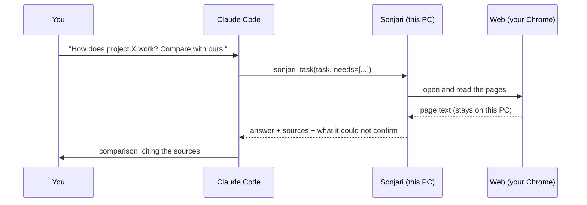
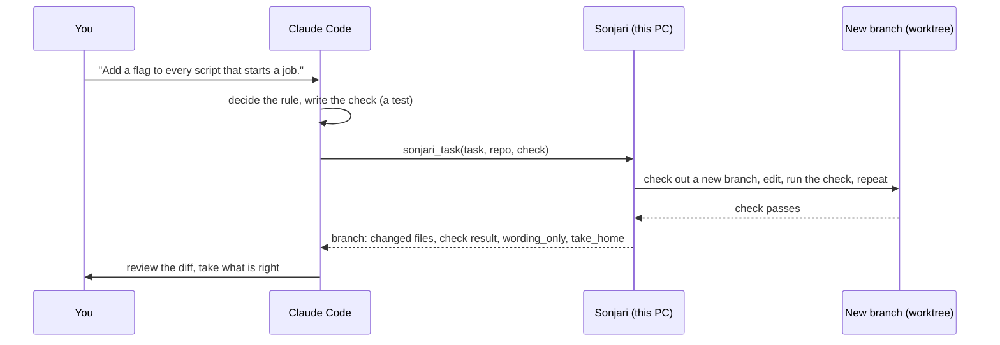

# How we use it — Claude Code + Sonjari

**English** · [한국어](workflows.ko.md)

This is how the maintainers actually work with Sonjari every day: Claude Code does the thinking, Sonjari does the reading
and the mechanical work on this PC. The numbers below are from real jobs on 2026-10-20, not from a demo.

**The rule of thumb**

| Give it to Sonjari | Keep it in Claude Code |
|---|---|
| reading many pages and returning a short result | design decisions, unfamiliar APIs |
| anything that needs your logged-in Chrome | anything you need in the next 30 seconds |
| narrow, mechanical edits across many files, with a check command | edits whose "done" you cannot write as a command |
| making Excel / Word / Hangul / PDF files | — |

Sonjari's local model is slower than Claude. What you buy is **context and usage**: the pages and files are read on this
PC, and only the result comes back into your Claude conversation.

---

## 1. Research — "read these and tell me"



**Real case.** We asked Claude Code to compare Sonjari with another open-source desktop agent. Claude handed the reading
to Sonjari in one call:

```text
sonjari_task(
  task="Read the README and docs of github.com/<org>/<repo> and summarize: what it is, how it drives the browser
        (library? screen coordinates? DOM?), whether it runs with a local model, supported OS, license, stars and last
        commit date. Separate what you confirmed from what you could not find.",
  needs=["what it is", "how it drives the browser", "local model", "license", "stars", "last commit"])
```

| | |
|---|---|
| time | 189 s |
| pages read on this PC | 6 |
| text kept out of Claude's context | at least 8,136 tokens (a lower bound — Korean text runs about 2× more) |
| `needs` | 5 of 6 filled, 1 "could not find the slot" — the answer had it, the check could not locate it |

Claude then wrote the comparison from Sonjari's answer and its `sources`, without opening a single page itself.

**Tips**
- Ask for "what you confirmed / what you could not find" — Sonjari is built to say "not found" rather than guess.
- Name the items you need in `needs`; you get a per-item check back.
- If a site needs a login, open it once in your own Chrome first. Sonjari uses that session; it never types passwords.

---

## 2. Coding — Claude designs, Sonjari applies and checks



**Real case.** 24 benchmark scripts start jobs on Sonjari's backend; each had to send `"measurement": true` in its request
body. Claude wrote the rule and a test, then handed the mechanical part over:

```text
sonjari_task(
  task="In every script under bench/ that starts a job via /v1/chat or /v1/jobs, add \"measurement\": True to the
        request body. Write tests/test_bench_scripts_mark_measurement.py that checks it.",
  repo="C:/work/sonjari",
  check="python -m pytest -q tests/test_bench_scripts_mark_measurement.py")
```

| | |
|---|---|
| time | 28.6 min (91 steps) — slow; most of it was the local model thinking |
| check | passed |
| files changed | 41 Python files (40 edited, 1 new test) |
| `branch.wording_only` | **16** — files where only a comment or docstring changed |

That last line is the important one. Our test only checked that the word "measurement" appeared in each file. Sonjari
satisfied it in 16 read-only scripts by adding a comment, not code. `wording_only` flagged exactly those 16 and none of the
24 code edits, so we took the 24 and dropped the 16 — then made the test check the request body instead.

**Tips**
- Write the check before you hand it over. A weak check gets a weak fix — `wording_only` tells you when that happened.
- Keep it narrow: one rule, many files, or one or two files. Big designs stay with Claude.
- Review with `branch.take_home.review`, take with `branch.take_home.take` (`cherry-pick -n`, nothing is committed for you).
- Your working folder is never touched; throw the branch away with `branch.take_home.discard`.

---

## 3. When Sonjari gets stuck

| You see | Do |
|---|---|
| `needs_decision` with a sign-in or CAPTCHA page | do just that step in Chrome; Sonjari continues by itself |
| `needs_decision` "stuck in the same place" | relay `message` (done / blocked / what you need to do) |
| `failed` with `resume` | start a new task from `resume.next`; do not reopen `resume.evidence` |
| a coding job that will not pass | turn on **Hand off to my Claude when stuck** (Settings › Connect, off by default) — or just take it back in Claude Code |

See also: [MCP guide](mcp.md) · [What leaves your PC](privacy.md) · [How Sonjari picks a model](models.md)
